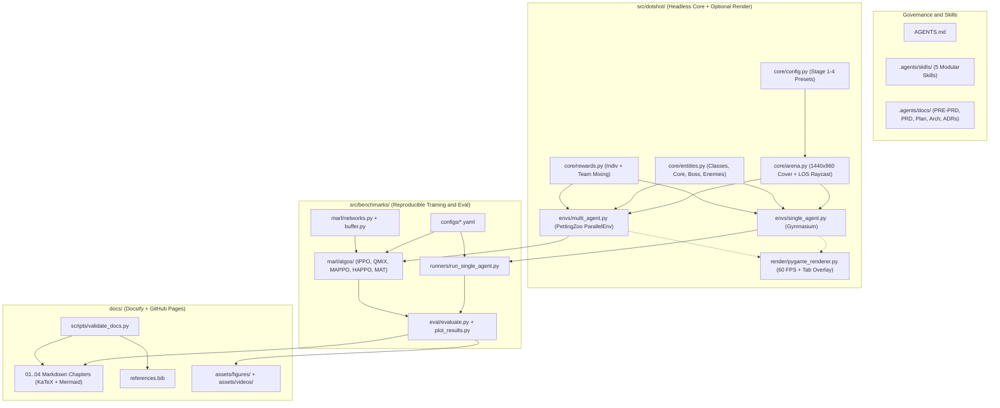
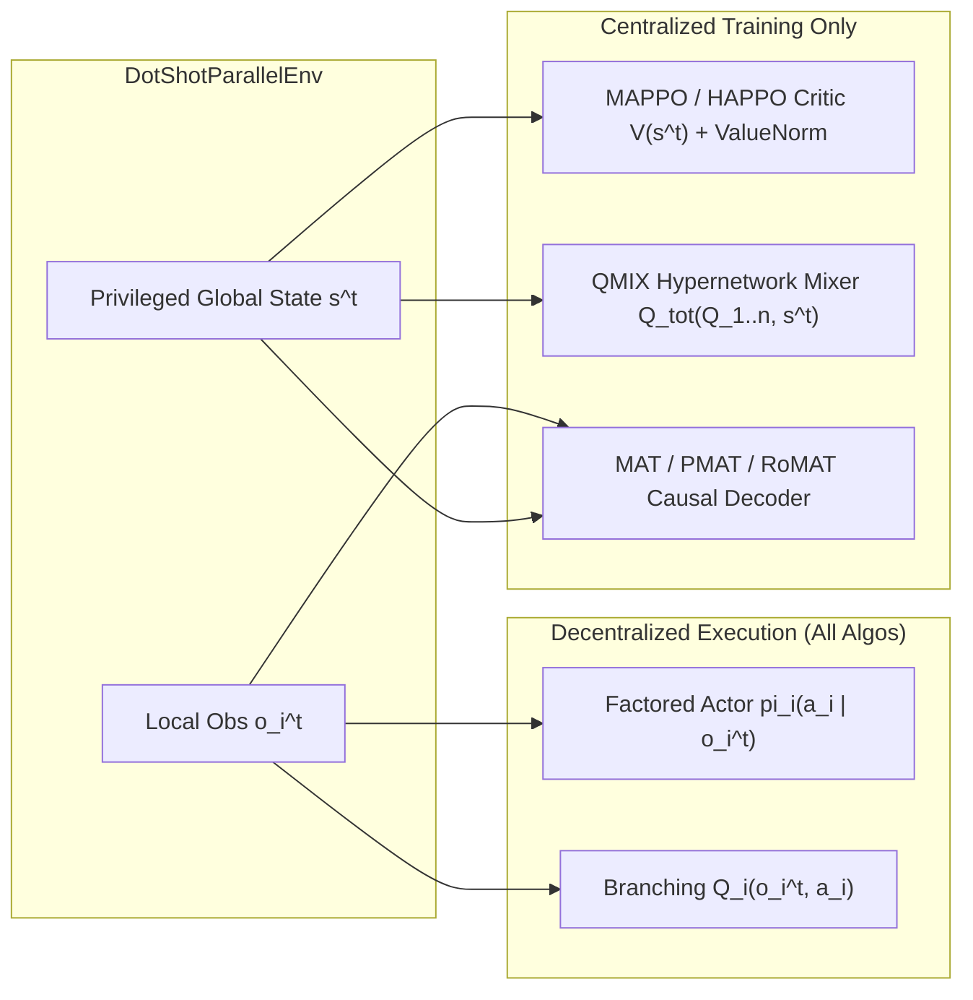

# Technical Architecture: DotShot Game v2

**Status:** Approved Baseline (Milestone 0)  
**Target Repository:** `antof27/RL-game1`  
**Related Specs:** [PRD.md](PRD.md) | [DECISIONS.md](DECISIONS.md) | [IMPLEMENTATION_PLAN.md](IMPLEMENTATION_PLAN.md)

---

## 1. System Topology

DotShot Game v2 separates simulation physics, rendering, RL/MARL training, statistical evaluation, and living documentation into explicit layers with strict unidirectional dependencies.



---

## 2. Target Repository Directory Tree

```text
RL/RL-game1/
|-- AGENTS.md                          # Permanent agent governance rules
|-- pyproject.toml                     # Editable package metadata (src/ layout for dotshot & benchmarks)
|-- requirements.txt                   # Pinned Windows CUDA dependencies
|-- .agents/
|   |-- docs/                          # PRE_PRD, PRD, IMPLEMENTATION_PLAN, ARCHITECTURE, DECISIONS, ROADMAP
|   |-- skills/                        # 12 workspace skills (humanizer, notelia-docs, scientific-latex-report, etc.)
|-- src/
|   |-- dotshot/
|   |   |-- __init__.py                # Registers Gymnasium Stage 1-2 IDs
|   |   |-- core/
|   |   |   |-- config.py              # Stage presets, class stats, arena geometry
|   |   |   |-- arena.py               # 1440x960 AABB obstacles, circle collisions, LOS raycasts, 8-ray LIDAR
|   |   |   |-- entities.py            # Agents (Vanguard/Striker/Support), Core, Enemies, ShieldedBoss, Bullets
|   |   |   |-- engine.py              # Pure headless simulation loop and smooth v2.1 aim/LOS caching
|   |   |   |-- rewards.py             # Individual + Team reward mixing and raw component telemetry
|   |   |-- envs/
|   |   |   |-- single_agent.py        # DotShotSingleEnv (Gymnasium Stages 1-2)
|   |   |   |-- multi_agent.py         # DotShotParallelEnv (PettingZoo ParallelEnv Stages 3-4)
|   |   |-- render/
|   |       |-- pygame_renderer.py     # Pre-cached neon glow renderer, HUD, MARL Tab overlay
|   |-- benchmarks/
|       |-- utils/
|       |   |-- seeding.py             # Deterministic seed + Git SHA + hardware capture
|       |   |-- logger.py              # TensorBoard + JSONL telemetry writer
|       |-- runners/
|       |   |-- run_single_agent.py    # Random, Heuristic, SB3 A2C, SB3 PPO
|       |-- marl/
|       |   |-- networks.py            # Factored Actor, Centralized Critic, Branching QMIX, Factored MAT/PMAT/RoMAT
|       |   |-- buffer.py              # On-policy MARL rollout buffer + off-policy episode replay buffer
|       |   |-- policy_loader.py       # Checkpoint loader for evaluation & enjoy.py
|       |   |-- vec_marl_env.py        # Vectorized Dummy/Subproc MARL env wrapper
|       |   |-- train_marl.py          # Unified YAML-driven MARL CLI
|       |   |-- algos/
|       |       |-- common.py, ippo.py, qmix.py, mappo.py, happo.py, mat.py
|       |-- eval/
|           |-- evaluate.py            # Multi-seed IQM, Median, Mean, 95% bootstrap CIs
|           |-- plot_results.py        # Learning curves, bar/radar charts, Markdown tables, MP4 clips
|-- configs/                           # Versioned YAML experiment definitions (stage1..stage4)
|-- docs/                              # Unified Docsify site, LaTeX paper/, results/*.json, assets/ (figures, screenshots, videos, legacy_v1_plots)
|-- scripts/
|   |-- enjoy.py                       # Manual play, checkpoint viewer, Tab overlay, MP4 export
|   |-- capture_screenshots.py         # Deterministic 1440x960 screenshot generator
|   |-- run_m2_suite.py                # Parallel CUDA Milestone 2 sweep orchestrator
|   |-- plot_m2_ablations.py           # Alpha and LOS ablation plotter
|   |-- validate_docs.py               # Citation, link, asset, and Humanizer prose validator
|-- tests/                             # pytest suite (single env, multi env, MARL algos)
|-- legacy_v1/                         # Archived v1 reference prototype (env/, marl/, models/, v1 CLI scripts)
```

---

## 3. Dec-POMDP State, Observation, and Action Schemas

### 3.1 Factored Action Space

Every agent $i \in \mathcal{I}$ uses a shared factored discrete action space:

$$\mathcal{A}_i = \text{MultiDiscrete}([3, 3, 32, 4])$$

- `a[0]`: horizontal movement $\{-1, 0, +1\}$ mapped from $\{0, 1, 2\}$
- `a[1]`: vertical movement $\{-1, 0, +1\}$ mapped from $\{0, 1, 2\}$
- `a[2]`: discrete aim angle bin $k \in \{0, \dots, 31\}$, corresponding to $\theta_k = \frac{2\pi k}{32}$ ($11.25^\circ$ angular resolution)
- `a[3]`: weapon / ability trigger:
  - `0`: Hold fire (or trigger class tactical ability when cooldown is ready in Stage 4, e.g., Vanguard directional shield pulse or Support repair/mark pulse, without forcing stray bullets)
  - `1`: Water projectile (counters Fire)
  - `2`: Grass projectile (counters Water)
  - `3`: Fire projectile (counters Grass)

### 3.2 Decentralized Local Observation $o_i^t$

All scalar features are normalized cleanly into $[-1.0, 1.0]$ as `np.float32`. Visibility to hostile entities is gated by distance and segment-AABB Line-of-Sight (LOS) in Stages 3–4 (when partial observability is enabled), ensuring genuine Dec-POMDP partial observability.

| Feature Block | Slot Count | Features per Slot | Dimensions |
| :--- | :---: | :--- | :---: |
| **Agent Self-State** | 1 | Normalized $(x, y)$, $(v_x, v_y)$, HP ratio, fire cooldown ratio, ability cooldown ratio, alive flag, last weapon one-hot (3), class role one-hot (3) | **14** |
| **Central Core State** | 1 | Relative $(\Delta x, \Delta y)$, distance, Core HP ratio, Core under-attack flag (0 in Stages 1–2) | **5** |
| **Obstacle / Wall LIDAR** | 8 | Normalized distance along 8 cardinal/diagonal rays ($0^\circ, 45^\circ, \dots, 315^\circ$) to nearest wall or cover block | **8** |
| **Top-$K$ Visible Hostiles** | $K = 5$ | Relative $(\Delta x, \Delta y)$, $(\sin\theta, \cos\theta)$, distance, velocity $(v_x, v_y)$, HP ratio, shield HP ratio, element one-hot (3), boss flag, marked debuff flag, active/LOS flag | $5 \times 15 = \mathbf{75}$ |
| **Teammates / Neutral Allies** | $M = 3$ | Relative $(\Delta x, \Delta y)$, distance, HP ratio, role/neutral one-hot (4), alive flag | $3 \times 9 = \mathbf{27}$ |
| **Total $D_{\text{obs}}$** | — | Fixed-dimension schema across Stages 1–4 for direct curriculum transfer | **129** |

Keeping $D_{\text{obs}} = 129$ identical across all four stages allows Stage 2 weights to transfer directly into Stage 3/4 actors in Milestone 3 without dimensional mismatch.

### 3.3 Privileged Global State $s^t$ (CTDE Only)

Exposed via `env.state()` for `Branching-QMIX`, `MAPPO`, `HAPPO`, `HATRPO`, and `MAT`:
- Full noise-free agent array ($N_{\max} \times 14$ features: all agents' positions, velocities, HP, cooldowns, roles, alive masks),
- Core state ($5$ features: position, HP, shield/threat density within radius),
- Full active enemy & boss array ($E_{\max} \times 15$ features regardless of agent LOS occlusion),
- Global wave telemetry ($4$ features: normalized wave index, enemies remaining, active boss count, elapsed episode progress).

---

## 4. CTDE Data Flow Across Algorithm Families



### Key Architectural Components (`benchmarks/marl/networks.py`)
1. **`FactoredMultiDiscreteActor`**: 2-layer `128`-unit MLP (or optional GRU) with orthogonal initialization and LayerNorm, branching into 4 independent linear logits (`[3, 3, 32, 4]`).
2. **`CentralizedCritic`**: 2-layer `256`-unit MLP consuming `s^t` (or `[s^t, o_i^t]`), paired with a running mean/std **ValueNorm** module to stabilize return scale shifts across waves.
3. **`BranchingQNetwork` + `QMIXMixer`**: Shared trunk computes scalar $V_i(o_i)$ and four centered branch advantages $A_i^{(k)}(o_i, a_i^{(k)})$; `QMIXMixer` passes `s^t` through hypernetworks constrained via `torch.abs()` to enforce $\frac{\partial Q_{\text{tot}}}{\partial Q_i} \ge 0$.
4. **`HAPPO` Sequential Update**: Agents maintain independent actor networks $\theta^1, \dots, \theta^n$. At each epoch, a random permutation $i_{1:n}$ is sampled; agent $i_m$ updates against the advantage weighted by the accumulated policy ratio $M^{i_{1:m-1}} = \prod_{j=1}^{m-1} \frac{\pi_{\text{new}}^{i_j}(a^{i_j} \mid o^{i_j})}{\pi_{\text{old}}^{i_j}(a^{i_j} \mid o^{i_j})}$.
5. **`FactoredMATNetwork`**: Transformer Encoder maps `[o_1, ..., o_n]` (plus optional `RoMAT` role embeddings) into contextual representations; Transformer Decoder autoregressively samples `a_i` along the fixed (`MAT`) or Plackett-Luce prioritized (`PMAT`) agent sequence using causal attention and 4 factored action embeddings summed per step.

---

## 5. Experiment Artifact Schema

Every experiment run writes to `runs/<stage>/<algo>/<exp_name>/seed_<k>/`:

```text
runs/stage3_coop/mappo/baseline_alpha0.7/seed_0/
|-- config.yaml        # Resolved config + git_sha + GPU/CPU versions + seed
|-- metrics.jsonl      # Step-aligned episodic returns, win rate, Core HP, accuracy, FPS
|-- tb/                # TensorBoard event files
|-- checkpoints/
    |-- best.pt        # Highest evaluation IQM / Win Rate checkpoint
    |-- final.pt       # Final step checkpoint
```
