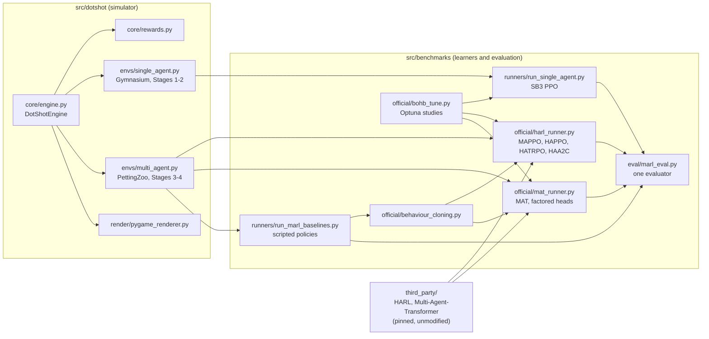

# Technical Architecture

**Simulator version:** DotShot v2.2 (`SIM_VERSION` in `src/dotshot/core/config.py`)
**Related:** [DECISIONS.md](DECISIONS.md) | [ROADMAP.md](ROADMAP.md) | [Simulator spec](../../docs/03-dotshot-simulator-spec.md)

---

## 1. System Overview



The simulator knows nothing about learners. Learners reach it only through the two environment wrappers. Every learner and every scripted baseline is scored by the same evaluator.

---

## 2. Repository Layout

```text
RL-game1/
|-- src/
|   |-- dotshot/
|   |   |-- core/
|   |   |   |-- arena.py          # Obstacles, circle collision, line of sight, 8-ray LIDAR
|   |   |   |-- config.py         # StageConfig presets, classes, elements (SIM_VERSION)
|   |   |   |-- engine.py         # Ticks, action repeat, observations, global state, behaviour audit
|   |   |   |-- entities.py       # Agents, enemies, bosses, projectiles, Core, neutral allies
|   |   |   `-- rewards.py        # Named individual and team reward terms
|   |   |-- envs/
|   |   |   |-- single_agent.py   # Gymnasium env, Stages 1-2
|   |   |   `-- multi_agent.py    # PettingZoo ParallelEnv, Stages 3-4
|   |   `-- render/
|   |       `-- pygame_renderer.py
|   `-- benchmarks/
|       |-- eval/
|       |   |-- marl_eval.py      # Seed splits, exact-n episodes, metrics, reward components
|       |   `-- evaluate.py       # Mean, IQM, bootstrap CIs, run aggregation
|       |-- official/             # Adapters around the pinned upstream learners
|       |   |-- harl_dotshot_env.py
|       |   |-- harl_runner.py
|       |   |-- mat_discrete.py
|       |   |-- mat_dotshot_env.py
|       |   |-- mat_runner.py
|       |   |-- behaviour_cloning.py
|       |   `-- bohb_tune.py
|       |-- runners/
|       |   |-- run_single_agent.py    # SB3 PPO, Stage 1 -> 2 transfer
|       |   `-- run_marl_baselines.py  # random, noop, charge, three heuristics
|       `-- utils/
|           |-- logger.py         # metrics.jsonl + TensorBoard + resolved config
|           `-- seeding.py        # Seeds, torch threads and VRAM cap, git and hardware info
|-- configs/
|   |-- official/                 # Tuned configs exported by bohb_tune.py (final runs)
|   |-- baselines/                # Scripted baselines
|   `-- ablations/                # Configs behind the development experiments (log §4.4)
|-- scripts/
|   |-- run_jobs.py               # Resumable multi-seed launcher
|   |-- optuna_lane.sh            # Runs several studies one after another
|   |-- optuna_status.py          # Study progress and best trials
|   |-- monitor_runs.py           # Learning curves plus behaviour flags
|   |-- report_final.py           # Final tables and figures
|   |-- check_gate.py             # Learner vs baselines acceptance check
|   |-- enjoy.py                  # Manual play and policy replay, MP4 export
|   |-- capture_screenshots.py
|   `-- validate_docs.py          # Citation and link checks
|-- tests/
|-- docs/                         # Handbook (docsify), report, results, assets
`-- third_party/                  # HARL and MAT as pinned git submodules
```

---

## 3. Environment Interfaces

| | Stages 1–2 | Stages 3–4 |
| :--- | :--- | :--- |
| Wrapper | `DotShotSingleEnv` (Gymnasium) | `DotShotParallelEnv` (PettingZoo) |
| Observation | `Box(-1, 1, (166,))` | per agent `Box(-1, 1, (166,))` |
| Global state | – | `state()`: 241 (Stage 3), 287 (Stage 4) |
| Action | `MultiDiscrete([3, 3, 32, 4])` | per agent `MultiDiscrete([3, 3, 32, 4])` |
| One `step` | 8 ticks (`action_repeat`) | 8 ticks |
| Reward | individual | one shared team reward per agent |

Both wrappers take `env_overrides`, a dictionary of `StageConfig` fields applied on top of the stage preset. Experiments use it for ablations (for example `action_repeat: 1`) instead of editing the presets. The `info` dictionary carries `reward_components` (per-episode sums of every named term), `episode_length` and the behaviour audit.

The layout of the observation, state and reward is specified in `docs/03-dotshot-simulator-spec.md`.

---

## 4. Learners

### 4.1 Single agent: Stable-Baselines3 PPO

`runners/run_single_agent.py` trains `PPO("MlpPolicy")` on 8 in-process environments (`DummyVecEnv`; on Windows subprocess IPC costs more than a simulator step). The multi-discrete action space gives four categorical heads. Stage 2 can start from a Stage 1 checkpoint (`init_model_path`); `reset_weapon_head` zeroes the weapon branch of the action head, because Stage 1 has only Fire enemies and that head collapses onto Water. After loading, the runner reseeds torch and the environments with the run seed (SB3 restores the checkpoint's seed on load).

### 4.2 Multi-agent: HARL (MAPPO, HAPPO, HATRPO, HAA2C)

`official/harl_runner.py` builds HARL's actors, critic and buffers from `third_party/HARL` and reuses its update code. `harl_dotshot_env.py` converts the PettingZoo env into HARL's list format. Corrections are applied from outside the submodule:

| Correction | Where |
| :--- | :--- |
| True joint PPO ratio: the joint log-prob is stored in 4 columns, so `action_aggregation: mean` instead of `prod` | config default |
| Per-branch entropy with masking, replacing a `(B, B)` tensor | `ACTLayer.evaluate_actions` patch |
| Dead agents reported as done so active masks drop them; never all done at once mid-episode, so a full wipe does not reset the episode | `harl_dotshot_env.py` |
| EP critic on the global state, one shared team reward | config default |
| MAPPO shares one actor on both stages | config default |
| Linear LR decay, minibatch counts, critic-only warm-up updates | config keys |
| Warm start from behaviour cloning (`warm_start: bc`) | `behaviour_cloning.py` |

### 4.3 Multi-agent: MAT

`official/mat_discrete.py` replaces MAT's action head with four categorical heads `(3, 3, 32, 4)`. Agents are still decoded one after another; each agent's joint log-prob and entropy are sums over its branches, stored in one buffer column. `mat_runner.py` adds the value of the last state to the final reward of time-limit truncations (MAT's buffer has no `bad_masks`) and uses the same evaluator and warm starts as HARL. MAT is the only learner that runs on the GPU.

### 4.4 Scripted baselines

`runners/run_marl_baselines.py`: `random`, `noop`, `charge` (walk into the nearest enemy, never fire), `heuristic_nearest`, `heuristic_core_guard` and `heuristic_calibrated` (dodges, guards the Core at 240 px, leads shots, picks the counter element, uses abilities). The calibrated script is the reference for the difficulty calibration and the teacher for behaviour cloning.

### 4.5 Behaviour cloning

`official/behaviour_cloning.py` records 200 episodes of the calibrated script, caches the dataset under `runs/`, and fits the actor (HARL or MAT) by maximum likelihood for 30 epochs. The critic then gets 10 critic-only updates before normal RL starts, so the first policy updates do not use advantages from an untrained critic.

---

## 5. Evaluation

`eval/marl_eval.py` is the only evaluator. Episode seeds come from two disjoint sets: `val` (base 1,000,003) for periodic evaluations, pruning and model selection, and `test` (base 2,000,003) for the final score; episode `i` uses `base + 7919 i`. Exactly `n` episodes are played; none is dropped or cut. After training, the final policy (never the best checkpoint) is scored on 32 `test` episodes. Metrics: return, win rate, kills, elemental and hit accuracy, Core HP, episode length, the behaviour audit and every reward component.

`eval/evaluate.py` aggregates seeds: mean with a 95% percentile bootstrap CI, median, and the IQM only when there are at least 4 values.

---

## 6. Hyperparameter Search

`official/bohb_tune.py` runs one Optuna study per stage and learner (`s1_sb3_ppo`, `s2_sb3_ppo`, `s{3,4}_harl_{mappo,happo,hatrpo,haa2c}`, `s{3,4}_mat`). Each has 24 trials with `TPESampler(multivariate=True)` and `HyperbandPruner` between 125k and 500k decisions (1M–4M ticks). A trial reports every 62.5k decisions on 16 `val` episodes of its first seed; one that reaches the full budget trains a second seed, and its objective is the mean final-policy return of both on 32 `val` episodes. The warm start is a categorical parameter. The best trial of each category is exported to `configs/official/<study>_<scratch|bc|transfer>.yaml` with the final budget. Storage is an Optuna journal file under `runs/optuna/` (SQLite needs SQLAlchemy extensions that the workstation's application control blocks).

---

## 7. Run Artifacts

`scripts/run_jobs.py` writes one directory per config and seed:

```text
runs/final/stage3/s3_harl_mappo_bc/seed_0/
|-- config.yaml        # resolved config, seed, git SHA, hardware
|-- metrics.jsonl      # train/* losses, eval/* val curves, test/* final scores
|-- tb/                # TensorBoard events
`-- checkpoints/
    |-- best/          # highest val return (replays only)
    `-- final/         # the policy that is reported
```

A run counts as complete once `metrics.jsonl` holds its `test/return_mean` row; `run_jobs.py` skips complete runs and restarts incomplete ones. `runs/` is not committed. Curated summaries go to `docs/results/`, figures to `docs/assets/figures/`.

---

## 8. Hardware Budget

Measured on the workstation (RTX 3060 12 GB, 8 physical cores): the pure-Python simulator bounds throughput, so HARL and SB3 run faster on the CPU than on CUDA (HARL Stage 3: 1,098 vs 754 environment steps per second). At most 6 training processes run at once, each GPU process is capped at 25% of the VRAM, and only the best and final checkpoints are kept.
