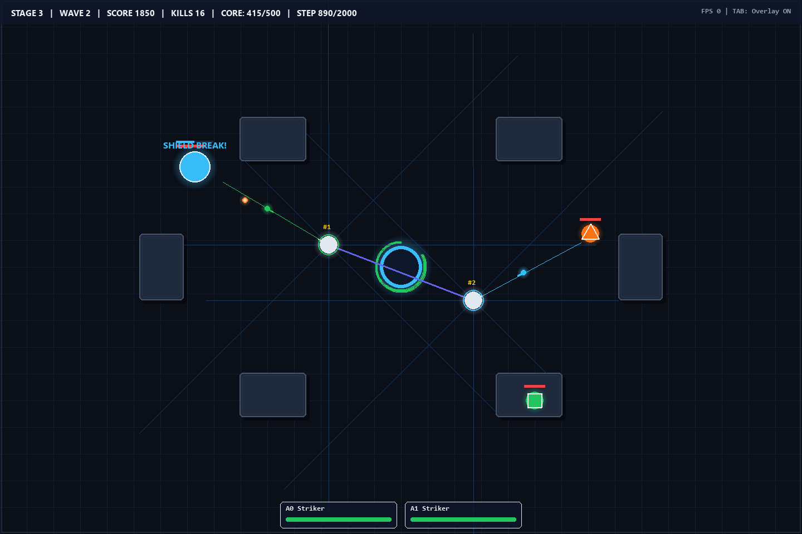
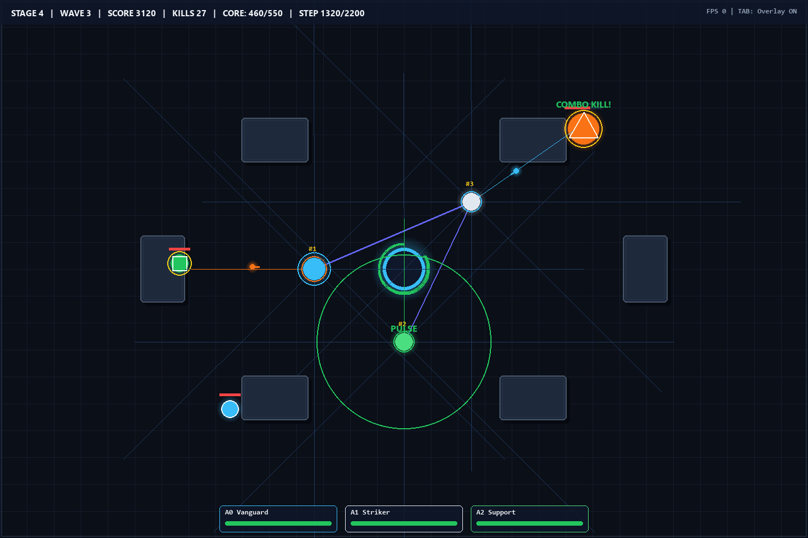

# DotShot

DotShot is a 2D arena shooter for single- and multi-agent reinforcement learning, with a benchmark suite and a research handbook in the same repository. Agents move, aim in 32 directions and fire one of three elemental weapons (Water beats Fire, Grass beats Water, Fire beats Grass) at waves of enemies. Four stages add one difficulty at a time:

| Stage | Interface | Agents | What it adds |
| :---: | :--- | :--- | :--- |
| 1 | Gymnasium | 1 Striker | aiming, leading targets, using cover |
| 2 | Gymnasium | 1 Striker | three enemy elements, enemy fire, neutral allies to avoid |
| 3 | PettingZoo | 2 Strikers | defending a central Core with limited vision, shielded bosses |
| 4 | PettingZoo | Vanguard, Striker, Support | heterogeneous roles with abilities |

| Stage 3 | Stage 4 |
| :---: | :---: |
|  |  |

Every agent acts in `MultiDiscrete([3, 3, 32, 4])` (horizontal move, vertical move, aim, weapon) once every 8 simulator ticks and observes a 166-value vector. Centralised critics also get a global state. The full specification, including every reward term, is in [docs/03-dotshot-simulator-spec.md](docs/03-dotshot-simulator-spec.md).

## Results

<!-- RESULTS: final 5-seed tables, filled in once the final runs finish. -->

## Learners

| Stages | Learner | Implementation |
| :---: | :--- | :--- |
| 1–2 | PPO | Stable-Baselines3 |
| 3–4 | MAPPO, HAPPO, HATRPO, HAA2C | [PKU-MARL/HARL](https://github.com/PKU-MARL/HARL), pinned submodule |
| 3–4 | MAT | [PKU-MARL/Multi-Agent-Transformer](https://github.com/PKU-MARL/Multi-Agent-Transformer), pinned submodule |

The upstream code is never edited. Adapters and corrections live in `src/benchmarks/official/`, and each correction is covered by a test. Every learner and every scripted baseline is scored by the same evaluator on held-out episode seeds.

## Repository Layout

```text
src/dotshot/        simulator: engine, rewards, Gymnasium and PettingZoo envs, Pygame renderer
src/benchmarks/     learners, scripted baselines, behaviour cloning, Optuna tuning, evaluation
configs/            official/ (tuned final configs), baselines/, ablations/
scripts/            run_jobs.py, monitor_runs.py, report_final.py, enjoy.py, ...
tests/              simulator, adapter and regression tests
docs/               handbook chapters, LaTeX report, curated results, screenshots
third_party/        HARL and Multi-Agent-Transformer (git submodules)
```

## Setup (Windows, Python 3.11)

```powershell
git clone --recursive https://github.com/antof27/DotShot.git
cd DotShot
python -m venv .venv
.\.venv\Scripts\Activate.ps1
pip install -e ".[dev]"
```

PyTorch with CUDA is only needed for MAT; the simulator, SB3 and HARL run faster on the CPU.

## Usage

```powershell
# Tests
.\.venv\Scripts\python.exe -m pytest

# Play a stage yourself (WASD, mouse aim, 1/2/3 elements, click or Space to fire, Tab for the overlay)
.\.venv\Scripts\python.exe scripts\enjoy.py --stage 3 --manual

# Scripted baselines (96 test episodes per policy)
.\.venv\Scripts\python.exe -m benchmarks.runners.run_marl_baselines --config configs\baselines\stage3_baselines.yaml

# Train a tuned configuration on 5 seeds (resumable)
.\.venv\Scripts\python.exe scripts\run_jobs.py --config configs\official\s3_harl_mappo_bc.yaml --seeds 0-4 --out runs\final\stage3 --workers 5

# Watch training curves and behaviour flags
.\.venv\Scripts\python.exe scripts\monitor_runs.py runs\final\stage3

# Tables and learning curves
.\.venv\Scripts\python.exe scripts\report_final.py --stage 3 --runs runs\final\stage3 --baselines runs\baselines\stage3 --out docs\results\final_stage3.json --figure docs\assets\figures\final_stage3_curves.png

# Hyperparameter search for one stage and learner
.\.venv\Scripts\python.exe -m benchmarks.official.bohb_tune --study s3_harl_mappo --device cpu
```

Run commands from the repository root with `PYTHONPATH=src` if the package is not installed.

## Documentation

- [Handbook](docs/README.md): from single-agent RL to cooperative MARL, the simulator specification and the experiment log. Serve it locally with `python -m http.server 8080 --directory docs`.
- [Report](docs/paper/dotshot_marl_report.pdf) ([LaTeX source](docs/paper/dotshot_marl_report.tex)).
- [Architecture](.agents/docs/ARCHITECTURE.md), [design decisions](.agents/docs/DECISIONS.md), [roadmap](.agents/docs/ROADMAP.md).
