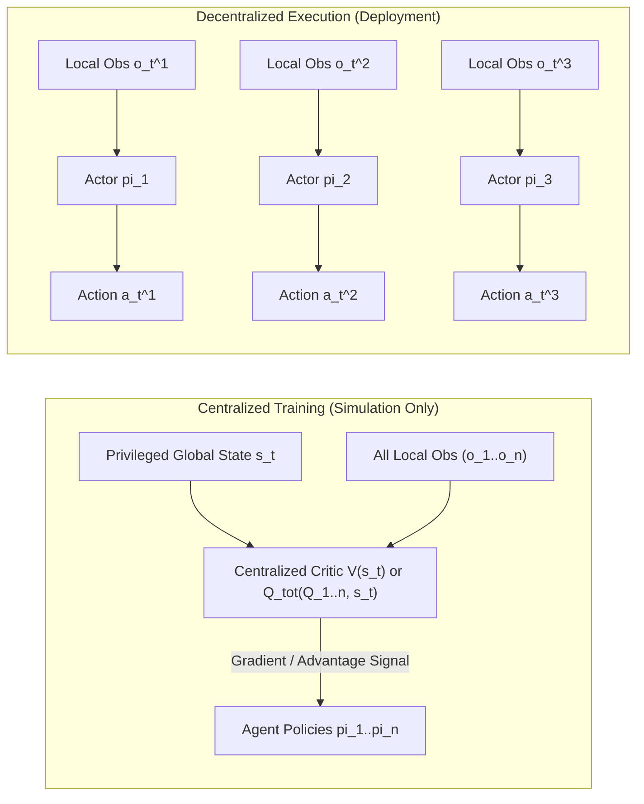
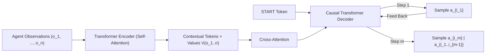

# 2. State of the Art in Cooperative Multi-Agent RL

> [!NOTE]
> **Learning Objectives**
> By the end of this chapter, you will be able to:
> 1. Explain the **Centralized Training with Decentralized Execution (CTDE)** paradigm and its theoretical scope.
> 2. Derive the **Individual-Global-Max (IGM)** condition and compare **VDN**, **QMIX**, **QTRAN**, and **QPLEX** across expressiveness and optimization tractability.
> 3. Contrast centralized-critic policy gradients (**MADDPG**, **COMA**, **MA-POCA**) with the on-policy renaissance (**IPPO**, **MAPPO**).
> 4. Prove why simultaneous multi-agent updates break monotonic improvement, and how **HATRPO**, **HAPPO**, **HARL/HAML**, and **Multi-Agent Transformer (MAT)** resolve this via the Multi-Agent Advantage Decomposition Lemma.
> 5. Apply modern statistical evaluation standards (*rliable* IQM + bootstrap CIs) and recognize 2024–2026 CTDE open frontiers.

---

## 2.1 The CTDE Paradigm

Fully centralized control over joint actions $\mathbf{a}_t \in \prod_i \mathcal{A}_i$ ignores execution bandwidth constraints and scales exponentially in $n$. Fully decentralized training (`IQL`, `IPPO`) suffers from non-stationarity and partial observability.

**Centralized Training with Decentralized Execution (CTDE)** bridges both extremes [@oliehoek2008optimal; @kraemer2016ctde; @amato2024ctde; @albrecht2024marl]. During simulation training, agents access extra information unavailable at test time: the true global state $s_t$, teammates' observations $\mathbf{o}_t$, and teammates' actions $\mathbf{a}_t$. Once training ends, every centralized critic, mixing network, or communication helper is removed. Each deployed policy $\pi_i(a_t^i \mid \tau_t^i)$ runs strictly on local observation-action history $\tau_t^i$.

Almost every modern cooperative MARL algorithm falls into one of five CTDE families:
1. **Value Function Factorization** (`VDN`, `QMIX`, `QTRAN`, `QPLEX`)
2. **Centralized-Critic Policy Gradients** (`MADDPG`, `COMA`, `MA-POCA`)
3. **On-Policy CTDE Actor-Critic** (`IPPO`, `MAPPO`)
4. **Heterogeneous Trust-Region & Mirror Learning** (`HATRPO`, `HAPPO`, `HARL`)
5. **Autoregressive Sequence Modeling** (`MAT`, `PMAT`, `RoMAT`)

---

## 2.2 Value Function Factorization (The IGM Family)

### Intuition and the IGM Condition

Suppose a centralized learner estimates the joint team action-value $Q_{\text{tot}}(\boldsymbol{\tau}, \mathbf{a})$. During decentralized execution, agent $i$ only knows $\tau^i$ and picks $\arg\max_{a^i} Q_i(\tau^i, a^i)$ greedily. For decentralized execution to recover the true global optimum without communication, local greedy choices must match the joint greedy choice. This requirement is the **Individual-Global-Max (IGM)** principle [@son2019qtran]:

> [!IMPORTANT]
> **Definition (IGM Condition)**
> Given individual utility functions $\{Q_i(\tau^i, a^i)\}_{i=1}^n$ and a joint action-value function $Q_{\text{tot}}(\boldsymbol{\tau}, \mathbf{a})$, IGM holds if and only if:
> $$\arg\max_{\mathbf{a}} Q_{\text{tot}}(\boldsymbol{\tau}, \mathbf{a}) = \begin{pmatrix} \arg\max_{a^1} Q_1(\tau^1, a^1) \\ \vdots \\ \arg\max_{a^n} Q_n(\tau^n, a^n) \end{pmatrix}$$

### VDN, QMIX, QTRAN, and QPLEX

- **VDN (Value-Decomposition Networks)** [@sunehag2018vdn] enforces IGM by assuming strict additivity:
  $$Q_{\text{tot}}^{\text{VDN}}(\boldsymbol{\tau}, \mathbf{a}) = \sum_{i=1}^n Q_i(\tau^i, a^i)$$
  Additivity trivially satisfies IGM, requires zero extra parameters, and uses no global state $s_t$. However, it cannot represent non-linear team interactions where an action's marginal value flips sign depending on what teammates are doing.

- **QMIX** [@rashid2018qmix] relaxes additivity to **monotonicity**:
  $$\frac{\partial Q_{\text{tot}}(\boldsymbol{\tau}, \mathbf{a})}{\partial Q_i(\tau^i, a^i)} \ge 0 \qquad \forall i \in \mathcal{I}$$
  A mixing network combines $[Q_1, \dots, Q_n]$ into $Q_{\text{tot}}$, while hypernetworks conditioned on the privileged global state $s_t$ generate the mixing weights. Applying `torch.abs()` to every mixing weight guarantees nonnegativity and therefore enforces monotonicity and IGM everywhere. In DotShot Stage 3, `Branching-QMIX` pairs this mixer with a **Branching Dueling Q-Network** [@tavakoli2018branching] so each agent evaluates `move_x`, `move_y`, `aim`, and `weapon` branches cleanly without flattening.

- **QTRAN** [@son2019qtran] and **QPLEX** [@wang2021qplex] address QMIX's representational ceiling on **non-monotonic tasks** (where true $Q_{\text{tot}}$ violates monotonicity). QTRAN introduces a transformed joint $Q'_{\text{tot}}$ and soft penalty constraints; QPLEX uses a duplex dueling attention architecture to achieve full IGM class completeness in principle, at the cost of higher variance and sensitivity to optimization hyperparameters.

---

## 2.3 Centralized-Critic Policy Gradients: MADDPG, COMA, and MA-POCA

Value-based factorization struggles in continuous or large multi-discrete action spaces unless combined with action branching. Actor-critic CTDE methods optimize decentralized policies directly against a centralized critic.

- **MADDPG** [@lowe2017maddpg] extends DDPG to mixed cooperative-competitive games. Each agent learns a centralized critic $Q_i^\phi(\mathbf{x}, a^1, \dots, a^n)$ conditioned on global state/observations $\mathbf{x}$ and all joint actions, updating deterministic or Gumbel-Softmax actors via $\nabla_{\theta_i} J = \mathbb{E}[\nabla_{\theta_i} \mu_i(o^i) \nabla_{a^i} Q_i^\phi(\mathbf{x}, \mathbf{a})|_{a^i = \mu_i(o^i)}]$. Conditioning on teammates' actions makes the critic target stationary even when policies change in the replay buffer.

- **COMA (Counterfactual Multi-Agent Policy Gradients)** [@foerster2018coma] targets cooperative credit assignment directly using a **counterfactual baseline**. Holding teammates' actions $\mathbf{a}^{-i}$ fixed, COMA computes agent $i$'s advantage by comparing the joint $Q$-value of its actual action $a^i$ against the marginal expectation over all alternative actions $\tilde{a}^i \in \mathcal{A}_i$:
  $$A^i(s, \mathbf{a}) = Q(s, \mathbf{a}) - \sum_{\tilde{a}^i} \pi^i(\tilde{a}^i \mid \tau^i) Q(s, (\mathbf{a}^{-i}, \tilde{a}^i))$$
  Any impact caused solely by $\mathbf{a}^{-i}$ cancels out. The limitation is computational: evaluating $\sum_{\tilde{a}^i}$ requires enumerating $|\mathcal{A}_i|$ actions per step, which works for small discrete sets (such as StarCraft unit actions) but becomes awkward for large factored spaces unless approximated.

- **MA-POCA** [@cohen2022mapoca] addresses **posthumous credit assignment** and dynamic team sizes (when agents die mid-episode or spawn dynamically). By passing active agents' observations through a permutation-invariant attention encoder, MA-POCA computes a counterfactual baseline across surviving agents so a teammate who sacrificed itself earlier still receives accurate credit for later Core survival.

---

## 2.4 The On-Policy CTDE Renaissance: IPPO and MAPPO

Throughout 2018–2020, off-policy value factorization (`QMIX`) dominated cooperative benchmarks while on-policy policy gradients were widely assumed too sample-inefficient. Two empirical papers overturned that consensus.

First, **IPPO** [@dewitt2020ippo] showed that carefully tuned independent PPO with clipped objectives and small learning rates matched or beat QMIX on several StarCraft Multi-Agent Challenge (SMAC) maps. Second, **MAPPO** [@yu2022mappo] demonstrated that on-policy CTDE PPO—conditioning a centralized state-value critic $V_\phi(s_t)$ (rather than a joint $Q(s_t, \mathbf{a}_t)$) on global state—consistently rivals or outperforms off-policy methods in both sample efficiency and final return across SMAC, Hanabi, MPE, and Google Research Football.

Yu et al. (2022) [@yu2022mappo] isolated five implementation details that decide whether MAPPO succeeds or stalls:
1. **Value Normalization (PopArt / running mean-std)** to absorb changing return scales over training.
2. **Global state design** combining agent-specific features with non-redundant global context.
3. **Small PPO clipping** ($\epsilon \le 0.2$) and limited epochs per rollout to keep policy drift controlled.
4. **Large rollout batch sizes** (avoiding tiny minibatches that amplify multi-agent gradient noise).
5. **Active/death masking** on actor and critic losses so terminated agents do not corrupt gradients.

### Where MAPPO Breaks: Simultaneous Updates and Parameter Sharing

Standard MAPPO relies on two simplifying assumptions:
- **Parameter Sharing ($\theta_1 = \dots = \theta_n$)**: Efficient for homogeneous squads (DotShot Stage 3), but brittle when agents have distinct capabilities, radii, speeds, and abilities (DotShot Stage 4: `Vanguard`, `Striker`, `Support`).
- **Simultaneous Policy Updates**: Updating every agent's policy simultaneously against a single shared advantage estimate lacks a monotonic joint-improvement guarantee. Two agents can over-correct toward each other's old behavior on the same step, causing oscillations.

---

## 2.5 Heterogeneous Trust-Region and Mirror Learning: HATRPO, HAPPO, and HARL

To eliminate both parameter sharing and simultaneous-update instability, **Kuba et al. (2022)** [@kuba2022happo] and **Zhong et al. (2024)** [@zhong2024harl] proved a central structural identity for cooperative Markov games.

> [!IMPORTANT]
> **Lemma (Multi-Agent Advantage Decomposition)** [@kuba2022happo]
> For any joint policy $\boldsymbol{\pi}$, any state $s$, any subset of agents $i_{1:m}$, and any joint action $\mathbf{a}^{i_{1:m}}$, the multi-agent joint advantage decomposes **exactly** without any value-factorization approximation:
> $$A_{\boldsymbol{\pi}}^{i_{1:m}}(s, \mathbf{a}^{i_{1:m}}) = \sum_{j=1}^m A_{\boldsymbol{\pi}}^{i_j}\!\left(s, \mathbf{a}^{i_{1:j-1}}, a^{i_j}\right)$$

Notice what this exact identity gives us: instead of assuming $Q_{\text{tot}}$ is additive or monotonic (as in VDN/QMIX), **we decompose the advantage sequentially across an arbitrary agent permutation $i_{1:n}$**.

### Sequential Update Mechanics in HAPPO and HATRPO

Let each agent $i$ maintain its own independent network $\theta^i$ (no parameter sharing). At each training iteration, sample a random permutation $i_{1:n}$ of all agents. Update agents one by one along $m = 1, \dots, n$ while maintaining a running sequential importance-sampling multiplier:

$$M^{i_{1:m}}(s, \mathbf{a}) = \prod_{j=1}^{m-1} \frac{\pi_{\bar{\theta}^{i_j}}^{i_j}(a^{i_j} \mid o^{i_j})}{\pi_{\theta_{\text{old}}^{i_j}}^{i_j}(a^{i_j} \mid o^{i_j})} \cdot \hat{A}(s, \mathbf{a})$$

- **HATRPO** optimizes each agent $i_m$'s expected $M^{i_{1:m}}$-weighted objective subject to a strict KL trust-region constraint $D_{\text{KL}}(\pi_{\text{old}}^{i_m} \| \pi_{\text{new}}^{i_m}) \le \delta$ via conjugate gradient and backtracking line search.
- **HAPPO** replaces the second-order KL step with a first-order PPO clipped surrogate over $\frac{\pi^{i_m}_{\theta}(a^{i_m} \mid o^{i_m})}{\pi^{i_m}_{\theta_{\text{old}}}(a^{i_m} \mid o^{i_m})}$ weighted by $M^{i_{1:m}}$ [@kuba2022happo].

**Zhong et al. (2024)** [@zhong2024harl] generalized this sequential scheme into **Heterogeneous-Agent Mirror Learning (HAML)** inside the **HARL** framework, proving **monotonic improvement of joint return** and convergence to **Nash Equilibrium** for heterogeneous agents across `HATRPO`, `HAPPO`, `HAA2C`, `HADDPG`, and `HATD3`.

---

## 2.6 MARL as Sequence Modeling: MAT, PMAT, and RoMAT

Examining the Multi-Agent Advantage Decomposition Lemma closely led **Wen et al. (2022)** [@wen2022mat] to a striking architectural bridge: if optimal joint policy search reduces to sequential per-agent decisions $a^{i_1} \to a^{i_2} \to \dots \to a^{i_n}$ conditioned on prior actions, then cooperative MARL is naturally an **encoder-decoder sequence modeling problem**.

- **MAT (Multi-Agent Transformer)** [@wen2022mat]: The Transformer encoder attends across all agents' observations $(o^1, \dots, o^n)$, producing contextual representations and value estimates. During training (or centralized rollout), the causal decoder generates each agent's action sequentially along a fixed order $[0, 1, \dots, n-1]$ conditioned on preceding agents' chosen actions. Because sequence length equals $n$ agents rather than $|\mathcal{A}|^n$, complexity scales linearly in $n$ while inheriting monotonic improvement from the advantage decomposition theorem.
- **PMAT (Prioritized MAT)**: Fixed ordering $[0, 1, \dots, n-1]$ can be suboptimal when the frontline tank or initiator should commit *before* the DPS or support unit reacts. PMAT introduces a lightweight priority network trained to sample a dynamic permutation via **Plackett-Luce** ranking so the highest-impact agent commits first on each step.
- **RoMAT (Role-based MAT)**: Injects learnable per-agent role embeddings into the encoder tokens so asymmetric squads (`Vanguard`, `Striker`, `Support`) preserve class specialization within a shared Transformer backbone.

> [!NOTE]
> **Wait: Does MAT Violate Decentralized Execution?**
> In MAT's strict centralized execution variant, agents coordinate sequentially through the decoder. To preserve decentralized execution where required, MAT-Dec restricts execution attention or distills the sequential policy into independent decentralized actors; in DotShot's simulator, we benchmark `MAT`/`PMAT`/`RoMAT` directly against fully decentralized `IPPO`, `QMIX`, `MAPPO`, and `HAPPO` to quantify the exact gain from explicit sequential action coordination.

---

## 2.7 Comparative Algorithm Matrix

| Algorithm | Policy / Value | Action Space Support | Parameter Sharing | Monotonic / Nash Guarantee | Primary Strength | Known Failure Mode |
| :--- | :--- | :--- | :--- | :--- | :--- | :--- |
| **IPPO** [@dewitt2020ippo] | On-policy AC | Discrete, Continuous, MultiDiscrete | Optional | None | Simple, fast baseline | Non-stationarity; partial observability |
| **VDN** [@sunehag2018vdn] | Off-policy Value | Discrete (or Branching) | Usually shared | IGM (additive only) | Minimal parameters | Fails on non-linear team payoffs |
| **QMIX** [@rashid2018qmix] | Off-policy Value | Discrete (or Branching) | Usually shared | IGM (monotonic) | Strong sample efficiency on monotonic tasks | Fails on non-monotonic payoff matrices |
| **COMA** [@foerster2018coma] | On-policy AC | Small Discrete | Shared | Policy gradient local | Explicit counterfactual credit assignment | Slow / noisy on large factored action spaces |
| **MAPPO** [@yu2022mappo] | On-policy CTDE AC | Discrete, Continuous, MultiDiscrete | Usually shared | Empirical stability only | Strong homogeneous baseline with ValueNorm | Struggles with asymmetric heterogeneous classes |
| **HAPPO / HATRPO** [@kuba2022happo; @zhong2024harl] | On-policy Sequential CTDE | Discrete, Continuous, MultiDiscrete | **No** (separate $\theta^i$) | **Yes** (Advantage Decomposition) | Handles heterogeneous squads without sharing | Higher memory/compute scaling linearly in $n$ |
| **MAT / PMAT / RoMAT** [@wen2022mat] | On-policy Sequence Model | Discrete, Continuous, MultiDiscrete | Shared Transformer + Role Emb | **Yes** (Sequential decoding) | Explicit action-to-action coordination in $O(n)$ | Requires centralized joint forward pass at step time unless distilled |

---

## 2.8 2024–2026 Frontiers and Rigorous Evaluation Standards

Recent cooperative MARL research focuses on three active gaps identified across 2024–2026 tutorials and benchmarks [@amato2024ctde; @albrecht2024marl]:

1. **Exploration Limits of Standard CTDE**: Amato (2024) [@amato2024ctde] highlights that standard CTDE only centralizes *value estimation* (critic/mixer), leaving joint exploration uncoordinated. Promising remedies include centralized teacher-student distillation, explicit belief-state modeling under partial observability, and synchronized multi-agent intrinsic exploration.
2. **Heterogeneity and Dynamic Teams**: Unified frameworks like HARL [@zhong2024harl] and attention-based posthumous credit assignment [@cohen2022mapoca] address asymmetric agents and mid-episode deaths—both central mechanics in DotShot Stage 4.
3. **Statistical Rigor Over Single-Seed Storytelling**: **Agarwal et al. (2021)** [@agarwal2021rliable] (*rliable*) and **Gorsane et al. (2022)** [@gorsane2022marleval] documented widespread statistical flaws in RL/MARL papers: cherry-picked seeds, uncalibrated point means, and missing confidence intervals. Every benchmark in [Chapter 4](04-experiments-log.md) therefore reports **Interquartile Mean (IQM)**, **Mean**, **Median**, and **95% stratified bootstrap confidence intervals** across multiple fixed seeds.

---

## 2.9 Quick Self-Check

1. **Why can QMIX fail even when a centralized critic is available during training?**
   

   
Show Answer

   QMIX constrains $Q_{\text{tot}}$ to be monotonic in every individual $Q_i$. If the true optimal joint value function requires non-monotonic coordination (where an agent's optimal action reverses depending on a teammate's unseen action), the monotonic mixer cannot represent the true $Q_{\text{tot}}$, inducing relative overgeneralization.
   

2. **What mathematical term links agent $i_m$'s update to previously updated agents $i_1, \dots, i_{m-1}$ in HAPPO?**
   

   
Show Answer

   The sequential importance-sampling multiplier $M^{i_{1:m-1}} = \prod_{j=1}^{m-1} \frac{\pi_{\text{new}}^{i_j}(a^{i_j} \mid o^{i_j})}{\pi_{\text{old}}^{i_j}(a^{i_j} \mid o^{i_j})}$, derived from the Multi-Agent Advantage Decomposition Lemma. Multiplying $\hat{A}$ by $M^{i_{1:m-1}}$ accounts for policy shifts already committed by earlier agents in the permutation.
   

3. **Why does Interquartile Mean (IQM) provide a cleaner benchmark summary than raw Mean or Median across 5–10 seeds?**
   

   
Show Answer

   Raw Mean is sensitive to a single lucky or crashed seed, while Median discards 80–90% of the sample information. IQM trims the top and bottom 25% outliers and averages the middle 50%, balancing outlier robustness with high statistical efficiency.
   

