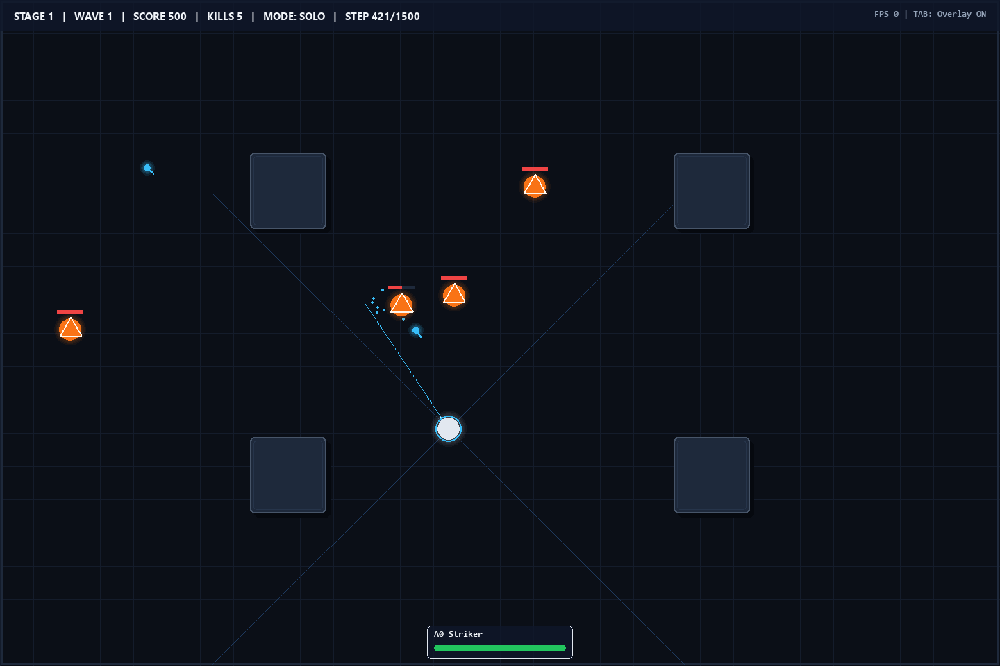
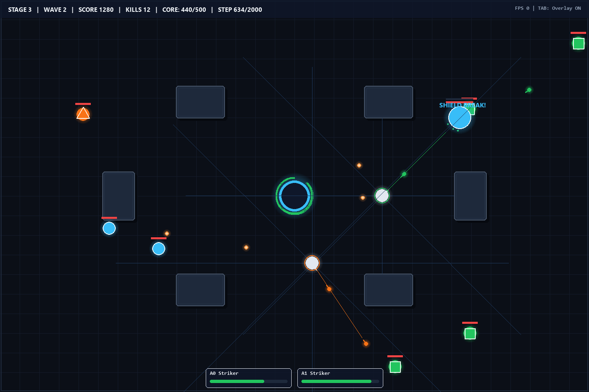

# 3. DotShot Simulator Specification (v2.2)

> [!NOTE]
> **What this chapter covers**
> 1. The arena, the entities and the rules of each of the four curriculum stages.
> 2. The exact action space, local observation (166 values) and global state used by every learner.
> 3. The reward: every term, its weight, and how individual and team terms are combined.
> 4. The design decisions behind DotShot v2.2 and the failures that motivated them.

All values come from `src/dotshot/core/` (`config.py`, `engine.py`, `entities.py`, `rewards.py`) at simulator version `SIM_VERSION = "2.2"`. If this page and the code disagree, the code is right and this page has a bug.

---

## 3.1 Overview

DotShot is a top-down 2D arena shooter. Agents move, aim in 32 directions and fire one of three elemental weapons at waves of elemental enemies. A weapon only damages an enemy of the element it counters, so each shot is a small decision: where to aim and which element to load. Four stages add one difficulty at a time, from a single agent shooting one enemy type to a heterogeneous three-agent squad defending a central Core under partial observability.

The simulator is pure Python and NumPy with no rendering dependency. `DotShotEngine` holds the physics and the reward. Two thin wrappers expose it: a Gymnasium environment for Stages 1–2 (`dotshot/envs/single_agent.py`) and a PettingZoo `ParallelEnv` for Stages 3–4 (`dotshot/envs/multi_agent.py`). A separate Pygame renderer (`dotshot/render/`) draws the same engine state for replays and screenshots.

### Time: ticks and decisions

The engine advances in **ticks**. An agent does not choose an action every tick: it chooses one every `action_repeat = 8` ticks, the action is held for those 8 ticks, and their rewards are summed into one transition. We call one such step a **decision**. A shot can only leave every 12–16 ticks (the fire cooldown), so at one decision per tick most aim and weapon choices had no effect and the learner could not tell which ones mattered (ADR-007). All training budgets in this handbook are given in ticks, so runs with different decision intervals compare at equal experience.

| Stage | Episode limit (ticks) | Decisions per full episode |
| :---: | :---: | :---: |
| 1 | 1,500 | 188 |
| 2 | 1,800 | 225 |
| 3 | 2,000 | 250 |
| 4 | 2,200 | 275 |

---

## 3.2 The Four-Stage Curriculum

| | Stage 1 | Stage 2 | Stage 3 | Stage 4 |
| :--- | :--- | :--- | :--- | :--- |
| Agents | 1 Striker | 1 Striker | 2 Strikers | Vanguard, Striker, Support |
| Interface | Gymnasium | Gymnasium | PettingZoo | PettingZoo |
| Enemy elements | Fire only | Water, Grass, Fire | all three | all three |
| Enemies at once | 4 | 6 | 8 | 10 |
| Enemies shoot | no | yes | yes | yes (17 damage) |
| Neutral allies | no | yes (friendly fire) | no | no |
| Bosses | no | no | every 8 kills | every 7 kills |
| Central Core | no | no | 500 HP | 550 HP |
| Observability | full | full | 760 px, line of sight | 760 px, line of sight |
| Death | ends the episode | ends the episode | respawn after 150 ticks | respawn after 150 ticks |
| Win | survive to the limit | survive to the limit | reach the limit with the Core alive | same |
| Reward | individual | individual | shared team reward | shared team reward |

What each stage teaches:

- **Stage 1: aiming and moving.** One enemy element, so the weapon choice is trivial. The agent must lead moving targets, use the four pillars as cover and avoid contact damage.
- **Stage 2: element choice.** Enemies of all three elements shoot back, and up to two neutral allies wander through the arena. A wrong-element hit does nothing to the enemy, and hitting a neutral ally is penalised. The agent has to read the element of its target and pick the counter.
- **Stage 3: cooperation.** Two Strikers defend a Core in the middle of the arena. They only see enemies within 760 px and in line of sight, so each must cover what the other cannot see. Bosses with elemental shields appear every 8 kills.
- **Stage 4: heterogeneous roles.** A Vanguard (tank with a taunting shield), a Striker (damage) and a Support (healing and target marking) share one Core. The roles differ in health, speed, fire rate and abilities, so one shared policy has to serve very different jobs, or each agent needs its own.

---

## 3.3 Arena and Entities

**Arena.** 1440 × 960 px with solid walls. Stages 1–2 place four 110 × 110 px pillars. Stages 3–4 place six blocks (four 120 × 80 px, two 80 × 120 px) around the Core. Every obstacle stops bullets and blocks line of sight. A bullet that hits an obstacle disappears without any penalty.

**Elements.** Water beats Fire, Grass beats Water, Fire beats Grass. A bullet of the counter element damages its target; any other element bounces off (`IMMUNE`) and deals no damage.

**Agent classes** (`ROLE_SPECS`):

| Class | HP | Speed (px/tick) | Radius | Fire cooldown (ticks) | Bullet damage | Bullet speed | Ability cooldown |
| :--- | :---: | :---: | :---: | :---: | :---: | :---: | :---: |
| Striker | 100 | 4.8 | 16 | 12 | 34 | 13.5 | – |
| Vanguard | 180 | 3.5 | 20 | 16 | 28 | 11.5 | 140 |
| Support | 115 | 4.3 | 16 | 14 | 24 | 12.5 | 120 |

**Abilities (Stage 4 only).** Choosing the hold-fire weapon action triggers the class ability when it is off cooldown and useful:

- *Vanguard, Aegis.* Needs an enemy within 380 px or an enemy projectile within 320 px. For 90 ticks the Vanguard takes 35% of incoming damage and pulls every enemy within 420 px toward itself.
- *Support, Pulse.* Needs a damaged Core or teammate, or an enemy within 440 px. Heals the Core by 26 HP (if within 420 px) and every teammate within 400 px by 22 HP, and marks the two nearest enemies for 150 ticks. A marked enemy takes 35% more damage, and killing it counts as a combo kill.
- *Striker.* No ability; holding fire just holds fire.

**Enemies** (`Enemy`, base values before difficulty scaling):

| Element | HP | Speed (px/tick) | Contact damage rate |
| :--- | :---: | :---: | :---: |
| Water | 95 | 2.00 | 18 |
| Grass | 140 | 1.35 | 24 |
| Fire | 72 | 2.75 | 15 |

Enemies spawn on the arena edges at least 220 px from every agent and the Core. On Stages 3–4 half of them (even ids) walk straight to the Core; the others chase the nearest live agent, unless an active Aegis taunts them. From Stage 2 on, an enemy fires a 5.4 px/tick projectile at its target every 75–130 ticks when the target is within 560 px and in line of sight. Projectiles deal 10 damage (17 on Stage 4), 1.4× for bosses. Touching an agent or the Core deals continuous contact damage.

**Waves and difficulty.** Every 10 team kills starts a new wave. The difficulty factor grows by 0.14 per wave, up to 2.4. It shortens the spawn interval (never below 14 ticks) and raises the HP of new enemies by 12% and their speed by 6% per unit of difficulty above 1.

**Bosses (Stages 3–4).** After 8 kills (7 on Stage 4) the next spawn is a boss: radius 28, 2.8× HP, 0.72× speed, 1.4× contact and projectile damage, plus a 110 HP elemental shield. Only counter-element hits damage the shield (at 1.15× damage). Breaking it opens a 160-tick window in which the boss takes 35% more damage and the class-specific shatter bonus applies.

**Neutral allies (Stage 2).** Up to two unarmed 50 HP units walk across the arena. They block bullets.

**Core (Stages 3–4).** A structure of radius 38 px in the centre. If its HP reaches zero the episode ends in defeat.

**Respawn (Stages 3–4).** A dead agent stays out for 150 ticks and then returns at its starting position with full health. Its observation is all zeros while it is dead.

---

## 3.4 Action Space

Every agent acts in `MultiDiscrete([3, 3, 32, 4])`:

| Branch | Values | Meaning |
| :--- | :--- | :--- |
| `a[0]` | 0, 1, 2 | horizontal move: left, none, right |
| `a[1]` | 0, 1, 2 | vertical move: up, none, down |
| `a[2]` | 0 … 31 | aim direction in 11.25° steps |
| `a[3]` | 0, 1, 2, 3 | hold fire (Stage 4: use ability), fire Water, fire Grass, fire Fire |

Diagonal moves are normalised to the class speed. A shot leaves only when the fire cooldown has expired and fewer than two of the agent's own bullets are already flying toward the enemy on the aim ray. All learners keep the four branches as separate categorical heads; the joint log-probability is the sum over branches.

---

## 3.5 Local Observation $o_i$ (166 values)

Each agent sees a vector in $[-1, 1]^{166}$ built from its own point of view. On Stages 3–4 only enemies within 760 px and in line of sight appear. Positions are relative to the agent and normalised by the arena size; empty slots are zero.

| Block | Size | Contents |
| :--- | :---: | :--- |
| 1. Self | 14 | position, velocity, HP, fire cooldown, ability cooldown, alive flag, last weapon (one-hot 3), class (one-hot 3) |
| 2. Core | 5 | direction and distance to the Core, Core HP, under-attack flag |
| 3. LIDAR | 8 | distance to walls and obstacles along 8 rays (range 480 px) |
| 4. Enemies | 5 × 15 | the 5 nearest visible enemies: relative position, bearing (sin, cos), distance, velocity, HP, shield, element (one-hot 3), boss flag, marked flag, present flag |
| 5. Teammates | 3 × 9 | the 3 nearest teammates or neutral allies: relative position, distance, HP, type (one-hot 4: Striker, Vanguard, Support, neutral), alive flag |
| 6. Projectiles | 4 × 7 | the 4 approaching enemy projectiles with the earliest closest approach: relative position, velocity, time to closest approach, miss distance, present flag |
| 7. Status | 5 | own Aegis timer, episode progress, direction to the enemy nearest the Core (if one is within 300 px of it), flag |
| 8. Crosshair | 4 | element (one-hot 3) of the visible enemy on the current aim ray, target flag |

Blocks 6–8 are new in v2.2. Without block 6 an agent could not dodge, because enemy bullets were invisible to it. Block 8 tells the agent which element it is pointing at, so element choice can be read off the input instead of being inferred from the enemy list.

## 3.6 Global State $s$ (centralised critics only)

Centralised critics (HARL's EP critic and MAT's value head) receive a noise-free state of size `16 n + 5 + 15 · max_enemies + 80 + 4`: 241 on Stage 3 and 287 on Stage 4.

| Block | Size | Contents |
| :--- | :---: | :--- |
| Agents | 16 per agent | absolute position, velocity, HP, cooldowns, alive flag, last weapon, class, Aegis timer, respawn timer |
| Core | 5 | position, HP, under-attack flag, alive flag |
| Enemies | 15 per slot | every enemy, sorted by distance to the centre: position, velocity, distance, HP, shield, element, boss, marked, counter element, shield-broken flag, present |
| Projectiles | 16 × 5 | position, direction and present flag of up to 16 enemy projectiles |
| Globals | 4 | wave, enemy count, boss present, episode progress |

---

## 3.7 Reward

The reward is a sum of named terms divided by 10. Each decision sums the rewards of its 8 ticks. Individual terms come from what one agent did; team terms from what happened to the team. Evaluations log every term separately (`rc_*` metrics), so any change in return can be traced to the terms that caused it.

### Individual terms (per agent, raw units before ÷10)

| Term | Weight | Paid when |
| :--- | ---: | :--- |
| `hits_correct` | +2.2 | per counter-element hit |
| `precision_hits` | +0.8 | per counter-element hit fired within about 28° of the lead point |
| `kills` | +5.0 | per kill |
| `boss_kills` | +10.0 | per boss kill |
| `shield_breaks` | +4.5 | per boss shield broken |
| `combo_kills` | +5.0 | per kill on an enemy damaged by two agents, marked, or with a broken shield |
| `aim_shaping` | +0.20 · cos² θ | per shot, θ = angle between the aim and the lead point of the priority threat (only when cos θ > 0) |
| `fire_element_credit` | +1.5 / −0.75 | per shot at an enemy on the aim ray: counter element / any other element |
| `shield_absorbed` | +0.05 | per HP absorbed by Aegis |
| `heal_utility` | +0.05 | per HP healed by Pulse |
| `mark_utility` | +0.8 | per enemy newly marked |
| `survival` | +0.015 | per tick alive |
| `hits_wrong` | −0.20 | per wrong-element hit |
| `missed_bullets` | −0.04 | per badly aimed bullet that leaves the arena |
| `ally_hits` / `ally_kills` | −2.0 / −5.0 | per neutral ally hit / killed (Stage 2) |
| `damage_taken` | −0.20 | per HP lost |
| `proximity_danger` | −0.15 × danger | per tick; danger grows linearly as enemies come within 140 px |
| `wall_bump` | −0.02 | per tick spent pushing into a wall |
| `death` | −5.0 | on death |

### Team terms (raw units before ÷10)

| Term | Weight | Paid when |
| :--- | ---: | :--- |
| `team_kills` | +2.5 | per enemy killed by anyone |
| `team_boss_kills` | +8.0 | per boss killed |
| `team_shield_breaks` | +3.5 | per boss shield broken |
| `team_combo_kills` | +4.0 | per combo kill |
| `team_wave_cleared` | +6.0 | when a new wave starts |
| `team_core_healed` | +0.04 | per Core HP healed |
| `team_core_alive` | +0.02 | per tick the Core stands |
| `team_core_damage` | −0.08 | per Core HP lost |
| `team_core_destroyed` | −12.0 | when the Core falls |
| `team_agent_died` | −3.0 | on any tick an agent dies |
| `team_win_bonus` | +20 × Core HP fraction | on reaching the episode limit with the Core alive |

### How the terms are combined

- **Stages 1–2** (one agent): $r = r_\text{indiv} / 10$. Team terms are not used.
- **Stages 3–4** (`reward_mode: team`): every agent, alive or dead, receives the same reward
  $$r^t = \frac{1}{n}\sum_{i=1}^{n} r^t_{i,\text{indiv}} + r^t_\text{team}.$$
  HAPPO and HATRPO assume a single shared reward, and a centralised critic on the global state can only predict a reward that does not depend on which agent is asking. The older per-agent mix $r_i = (1-\alpha)\,r_{i,\text{indiv}} + \alpha\,r_\text{team}$ remains available as `reward_mode: mixed` for ablations.

### Why the shaping terms look the way they do

Three shaping terms were redesigned in v2.2 after they were caught teaching the wrong thing.

- **Aim shaping is paid only on firing ticks.** In v2.1 it was paid every tick for pointing at the current position of the nearest enemy, whether or not the agent fired. In the Phase 1 gate run it out-paid correct hits 3.6 to 1, so a learner could collect it without ever shooting well. It now rewards a shot aimed where the most urgent enemy *will be*: the lead point of the enemy closest to the Core when one is within 300 px of it, otherwise of the nearest visible enemy.
- **The element credit has zero mean.** Paying it at fire time gives the weapon branch an immediate signal; otherwise it only learns from hits that land many ticks later. A symmetric ±0.6 version taught agents to hold fire (40% of actions), because a shot with an uncertain element had negative expected value. With +c for the counter element and −c/2 otherwise, a uniformly random weapon earns exactly zero in expectation (one right element out of three), so the term teaches element choice without discouraging fire.
- **Misses into pillars are free.** Only bullets that leave the arena unaimed are penalised.

An optional potential-based guard term (`guard_potential_coef`, off by default) adds $\gamma\,\Phi(s') - \Phi(s)$, with $\Phi$ the negative mean distance of live agents to the Core. Potential-based shaping leaves the optimal policy unchanged [@ng1999shaping]. It did not speed up learning in our tests (§4.4) and is not used in any reported run.

---

## 3.8 Episode End and Victory

- **Stages 1–2.** The episode ends when the agent dies (terminated) or at the tick limit (truncated). Reaching the limit alive counts as a win.
- **Stages 3–4.** The episode ends early only when the Core is destroyed. Reaching the tick limit with the Core alive is a **terminal victory** that pays the win bonus. The step is marked terminal because HARL drops the reward of steps marked as truncated.

### Why v2.2 changed these rules

In v2.1 an episode on Stages 3–4 also ended when every agent was dead, and the Core-damage penalties stopped with it. A scripted policy that walked into the nearest enemy and never fired (`charge`) therefore scored better than standing still or acting at random, and better than every learner of the first Milestone 3 run. Dying fast was the best strategy available to a team that had not yet learned to shoot. With respawn, only the Core's death ends an episode, so a team that dies keeps losing Core HP until it learns to defend. `charge` is now the worst baseline on both stages (§4.2).

---

## 3.9 Difficulty Calibration

The difficulty was set so that a strong scripted policy wins most, but not all, episodes. `heuristic_calibrated` (`benchmarks/runners/run_marl_baselines.py`) dodges incoming projectiles, holds a 240 px guard ring around the Core, leads its shots, picks the counter element and uses the Stage 4 abilities. Parameters were changed one at a time and scored on 32–96 `val` episodes (`docs/results/dev/calibration_log.jsonl`). With the v2.1 settings this script won every Stage 4 episode with 84% Core HP left, so Stage 4 enemy projectiles now deal 17 damage instead of 10. Stage 3 kept its settings.

At the final settings and `action_repeat = 8`, on 96 held-out `test` episodes, the script wins 78.1% of Stage 3 episodes and 75.0% of Stage 4 episodes, while `noop`, `random` and `charge` win none.

---

## 3.10 Behaviour Audit

Every evaluation also records how the policy behaves, because a high return can hide a degenerate strategy:

| Metric | Meaning |
| :--- | :--- |
| `hold_frac` | share of live-agent ticks spent holding fire |
| `move_frac` | share of live-agent ticks spent moving |
| `shots_per_100` | shots fired per 100 live-agent ticks |
| `deaths` | deaths per episode |
| `core_dist` | mean distance to the Core (Stages 3–4) |

`scripts/monitor_runs.py` flags a run as `IDLE` (moves less than 15% of the time), `NOFIRE` (holds fire more than 80% of the time, or fires less than once per 100 ticks), `SUICIDE` (more than 3 deaths per agent per 1,000 ticks) or `ELEM<33` (elemental accuracy at or below chance). Every reported policy was checked against these flags.

---

## 3.11 Renderer

The physics never imports Pygame. `DotShotPygameRenderer` draws an engine state at 1440 × 960 and can run headless (`SDL_VIDEODRIVER=dummy`) for videos and screenshots. `Tab` toggles an overlay with LIDAR rays and aim lines. `scripts/enjoy.py` plays any stage by hand or replays a trained run on a held-out test episode; with `--snapshots` it saves frames at ticks or events of a replay. The gallery below shows the final trained policies (Stage 1 PPO, Stage 2 PPO transferred from Stage 1, Stage 3 MAT and Stage 4 MAPPO, both started from the cloned script).

### Stage 1

### Stage 2

### Stage 3

### Stage 4

