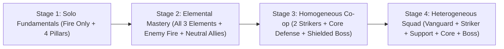
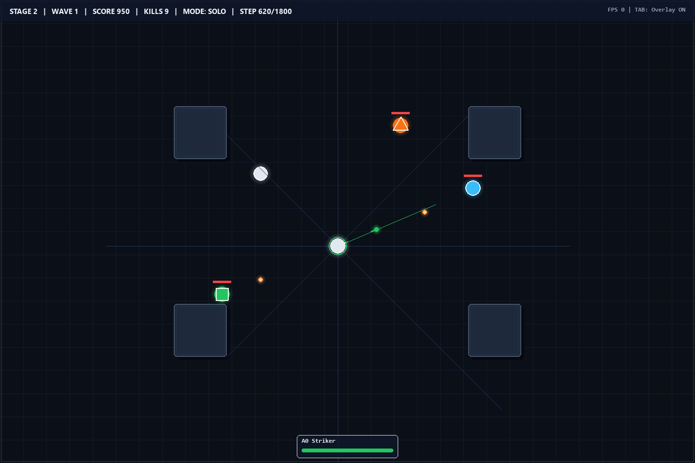
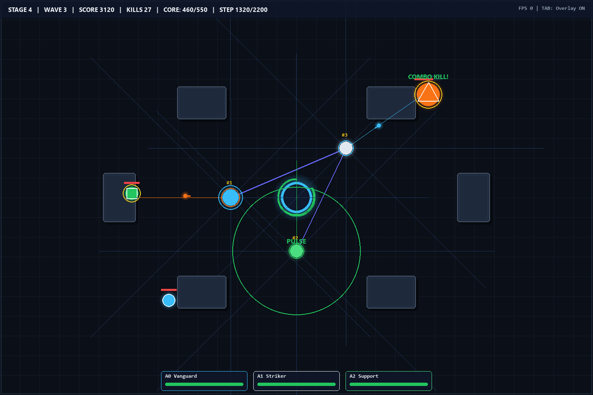

# 3. DotShot Game v2: Simulator Specification and Engineering Post-Mortem

> [!NOTE]
> **Learning Objectives**
> By the end of this chapter, you will be able to:
> 1. Read the formal Dec-POMDP specification of **DotShot Game v2** across all four curriculum stages.
> 2. Trace exact dimensions for local observations $o_i^t$, privileged global state $s^t$, factored actions, and reward mixing.
> 3. Understand why specific simulator upgrades were introduced between DotShot v1 and DotShot v2 to expose measurable differences among MARL algorithms.

---

## 3.1 Why DotShot v1 Was Not Enough (Engineering Post-Mortem)

DotShot v1 (`legacy_v1/env/game_env.py` and `legacy_v1/marl/train_marl.py`) proved that PPO and early Transformer prototypes could learn elemental shooting in an `800×800` box. However, auditing v1 exposed five design bottlenecks that prevented rigorous MARL research:

| Component | DotShot v1 Limitation | DotShot v2 Engineering Solution | Impact on MARL Benchmarking |
| :--- | :--- | :--- | :--- |
| **Arena & Occlusion** | Empty `800×800` square; zero obstacles or vision gating | `1440×960` arena with beveled rectangular cover blocks, circle-AABB collisions, and segment-AABB Line-of-Sight (LOS) raycasts | Creates genuine partial observability under cover and forces coordinated flanking |
| **Team Objective** | Two identical agents surviving random waves independently | Central Energy Core (`HP = 500`) + periodic **Elemental-Shielded Bosses** | Forces joint defense, shield-break windows, and focus-fire combos |
| **Agent Diversity** | Homogeneous stats and weapons across all agents | Stage 4 heterogeneous squad: **Vanguard** (Tank), **Striker** (DPS), **Support** (Healer/Marker) | Tests parameter-sharing `MAPPO` failure modes vs `HAPPO`/`HATRPO` and `RoMAT` |
| **Action Encoding** | `legacy_v1/marl/train_marl.py` flattened `MultiDiscrete([3,3,64,4])` into a `2304`-class integer | Factored `MultiDiscrete([3, 3, 32, 4])` policy heads and Branching Dueling Q-heads [@tavakoli2018branching] | Eliminates `2304`-way softmax explosion and preserves angular locality |
| **Environment API** | Concatenated vector inside one Gymnasium `Box` | Dual standard APIs: **Gymnasium** (`Stages 1–2`) + **PettingZoo `ParallelEnv`** (`Stages 3–4`) with explicit `env.state()` | Cleanly separates decentralized $o_i^t$ from centralized CTDE $s^t$ |

---

## 3.2 Four-Stage Progressive Curriculum

| Stage | Env / API | Agents & Roles | Enemies & Hazards | Core Mechanics Tested |
| :---: | :--- | :--- | :--- | :--- |
| **Stage 1** | `DotShot-Stage1-v1` (Gymnasium) | 1 `Striker` | `Fire` enemies (max 4), 4 cover pillars | Kiting, obstacle collision, target leading, Water shot selection |
| **Stage 2** | `DotShot-Stage2-v1` (Gymnasium) | 1 `Striker` | `Water/Grass/Fire` (max 6), enemy shots, neutral allies | Cyclic weapon switching, projectile dodging, friendly-fire avoidance |
| **Stage 3** | `DotShotParallelEnv(stage=3)` (PettingZoo) | 2 `Striker` agents | Mixed waves (max 8), **Shielded Boss** every 8 kills, 6 cover blocks, LOS partial obs | Core defense, focus-fire combos, CTDE credit assignment |
| **Stage 4** | `DotShotParallelEnv(stage=4)` (PettingZoo) | 3 agents: `Vanguard`, `Striker`, `Support` | Heavy waves (max 10), **Shielded Boss** every 7 kills, LOS partial obs | Asymmetric role specialization, shield aggro, repair/mark synergy |

---

## 3.3 Formal Dec-POMDP Specification

DotShot Stages 3 and 4 instantiate a finite-horizon cooperative Dec-POMDP [@oliehoek2016decpomdp] $\mathcal{G} = \langle \mathcal{I}, \mathcal{S}, \mathcal{A}, \mathcal{P}, \mathcal{R}, \Omega, \mathcal{O}, \gamma \rangle$:

### Elemental Advantage Graph and Boss Shield Mechanics
- Weapons and enemies belong to `{0: Water, 1: Grass, 2: Fire}`.
- Counter relation: **Water beats Fire**, **Grass beats Water**, **Fire beats Grass**. Mismatched hits deal `0` hull damage and trigger an `IMMUNE` event plus a wrong-element penalty.
- In Stages 3 and 4, periodic **Shielded Bosses** spawn with an elemental shield (`110+` HP). While the shield remains intact, hull damage is reduced by `90%`. Shattering the shield with the counter-element opens a `160`-tick vulnerability window (`+35%` team damage, `+35%` bonus for Striker) and awards team shield-break and combo-kill bonuses.

### Factored Action Space $\mathcal{A}_i$
Every agent $i$ selects a 4-tuple from `MultiDiscrete([3, 3, 32, 4])`:
- $a_{i,0} \in \{0, 1, 2\} \mapsto \{-1, 0, +1\}$ horizontal movement (normalized so diagonals preserve unit speed).
- $a_{i,1} \in \{0, 1, 2\} \mapsto \{-1, 0, +1\}$ vertical movement.
- $a_{i,2} \in \{0, \dots, 31\}$ aim angle $\theta_k = \frac{2\pi k}{32}$ (`11.25°` bins).
- $a_{i,3} \in \{0, 1, 2, 3\}$: `0` holds fire (and triggers the Stage 4 class tactical ability when cooldown is ready and threats or wounded allies are in range), `1` fires Water, `2` fires Grass, `3` fires Fire.

### Local Observation $o_i^t \in [-1, 1]^{129}$ vs Privileged Global State $s^t$

To support direct Stage 2 $\to$ Stage 3/4 transfer without tensor reshaping, every agent across all stages receives a fixed `129`-dimensional `float32` observation vector:
1. **Self-State (`14`)**: normalized $(x, y)$, normalized velocity $(v_x, v_y)$, HP ratio, fire cooldown, ability cooldown, alive flag, last fired weapon one-hot (3), class role one-hot (3).
2. **Central Core State (`5`)**: relative $(\Delta x, \Delta y)$, normalized distance, Core HP ratio, Core under-attack flag (`0` in Stages 1–2).
3. **Obstacle / Wall LIDAR (`8`)**: 8-direction raycast distances (`max_range = 480 px`) mapped into `[-1, 1]`.
4. **Top-5 Visible Hostiles (`5 × 15 = 75`)**: relative $(\Delta x, \Delta y)$, $(\sin\theta, \cos\theta)$, normalized distance, enemy velocity $(v_x, v_y)$ for target leading, HP ratio, boss shield ratio, element one-hot (3), boss flag, marked debuff flag, active/LOS flag. In Stages 3–4 (`partial_obs=True`), enemies beyond `760 px` or occluded by cover blocks are masked out.
5. **Teammates / Neutral Allies (`3 × 9 = 27`)**: relative $(\Delta x, \Delta y)$, distance, HP ratio, role/neutral one-hot (4), alive flag.

During training, `env.state()` exposes the privileged noise-free global state $s^t$ containing all agent states (`N × 14`), Core state (`5`), all active enemies up to `max_enemies` regardless of LOS occlusion (`E_max × 15`), and global wave progress (`4`).

### Decomposed Individual/Team Reward Function

Per-step reward mixes individual combat shaping with team outcomes via explicit parameter $\alpha \in [0, 1]$:

$$r_i^t = (1 - \alpha) r_{i,\text{indiv}}^t + \alpha r_{\text{team}}^t$$

- **$r_{i,\text{indiv}}^t$**: rewards correct hits, precision target-leading hits, solo kills, Vanguard damage absorption, Support heal/mark utility, and smooth forward-hemisphere aim alignment; penalizes wrong-element shots, missed shots (`-0.04` flat penalty per miss), friendly fire, contact/projectile damage, proximity danger, and death.
- **$r_{\text{team}}^t$**: rewards team eliminations, boss kills, shield breaks, multi-agent combo kills, wave clears, and Core healing; penalizes Core damage, Core destruction, and teammate deaths.

Exposing $\alpha$ in YAML configs enables controlled credit-assignment ablations without touching simulator code.

### Reward Shaping v2.1 and Throughput Optimization

Milestone 2 introduces **Reward Shaping v2.1** (`src/dotshot/core/engine.py`, `src/dotshot/core/rewards.py`) and vectorization optimizations (`src/benchmarks/marl/vec_marl_env.py`) to remove early exploration deadlocks and speed up multi-seed sweeps on Windows:

| Component | v2.0 Baseline | v2.1 Upgrade | Measured Impact |
| :--- | :--- | :--- | :--- |
| **Aim Alignment Shaping** | Step cliff (`best_dot > 0.90` binary threshold) | Smooth quadratic cosine `(best_dot ** 2) * 0.25` across `best_dot > 0` | Provides dense angular gradient across all `32` aim bins (`11.25°`) |
| **Hold-Fire (`a[3] == 0`)** | Awarded passive trigger-discipline points | Triggers Stage 4 class tactical ability only (hold-fire farming removed) | Prevents pacifist policies from gaming survival/hold-fire rewards |
| **Miss & Combat Signals** | Escalating episode miss penalty, lower hit/kill scale | Flat `-0.04` miss penalty (`r_indiv_raw`) with boosted hit (`2.2`) and kill (`5.0`) signals | Encourages active engagement while keeping spray-and-pray unprofitable |
| **LOS Obstacle Cache** | Filtered `obstacles` per raycast query | Pre-cached `_los_obstacles` tuple on engine init | Single-env throughput reaches `24,388 steps/sec` |
| **MARL Vectorization** | `SubprocMARLEnv` (`vec_type="subproc"`, `~470 FPS` on Windows) | `DummyMARLEnv` (`vec_type="dummy"`, `2,349 env_steps/sec` on Windows) | Eliminates Windows `spawn` pipe IPC overhead (`5.0×` speedup) |

---

## 3.4 Heterogeneous Squad Classes (Stage 4)

| Class | Max HP | Speed | Bullet Damage | Cooldown (Fire / Ability) | Tactical Ability (`a[3] == 0`) |
| :--- | :---: | :---: | :---: | :---: | :--- |
| **Vanguard** | `180` | `3.5` | `28` | `16 / 140` | Activates **Aegis Shield** (90 ticks, 65% damage mitigation, pulls enemy aggro within `420 px`) |
| **Striker** | `100` | `4.8` | `34` | `12 / 90` | High-mobility DPS (`+35%` bonus damage against shattered boss shields) |
| **Support** | `115` | `4.3` | `24` | `14 / 120` | Emits **Repair & Mark Pulse** (`+26` Core HP, `+22` ally HP, marks 2 enemies for `+35%` team damage) |

---

## 3.5 Renderer Architecture and MARL Explainability Overlay

Physics in `src/dotshot/core/` never imports `pygame`. When `scripts/enjoy.py` or video recording attaches `DotShotPygameRenderer`, pre-cached radial glow sprites and static background surfaces sustain 60 FPS at `1440×960`. Pressing `Tab` toggles the **MARL Explainability Overlay**, rendering 8-ray LIDAR ticks, aim lasers, and live `MAT`/`PMAT` execution priority badges (`#1`, `#2`, `#3`) directly over the arena.

---

## 3.6 Visual Gallery Across Curriculum Stages

All four screenshots below were captured deterministically at `1440×960` using headless `SDL_VIDEODRIVER=dummy` rendering (`scripts/capture_screenshots.py`) with the `Tab` explainability overlay enabled.

### Stage 1: Single-Agent Cover Combat

*Caption: Stage 1 solo arena (`Step 340/1500`, `Score 400`, `Kills 4`). The white circular `Striker` (`A0`) fires blue `Water` projectiles along a cyan aim laser toward approaching orange `Fire` triangles, while four square beveled pillars define cover corridors and 8-direction blue LIDAR rays track obstacle distances.*

**Dec-POMDP Link**: Stage 1 isolates core motor control—combining `11.25°` aim discretization, velocity-based target leading, and obstacle collision avoidance—before multi-element switching or partial observability enter the task.

### Stage 2: Elemental Mastery and Friendly-Fire Avoidance

*Caption: Stage 2 solo arena (`Step 620/1800`, `Score 950`, `Kills 9`). The `Striker` switches to a green `Grass` laser and fires a `Grass` projectile at a blue `Water` circle while dodging incoming orange enemy shots, tracking an orange `Fire` triangle and a green `Grass` square near cover, and holding fire around an unarmed white neutral ally.*

**Dec-POMDP Link**: Wrong-element hits deal zero hull damage (`IMMUNE`) and trigger negative reward, while hitting a neutral ally incurs a friendly-fire penalty. The policy must condition weapon selection (`a[3]`) on enemy element one-hots and distinguish hostile silhouettes from neutral teammates.

### Stage 3: Cooperative Core Defense and Boss Shield Break

*Caption: Stage 3 two-agent cooperative arena (`Step 890/2000`, `Core 415/500`, `Kills 16`). Two `Striker` units (`#1` and `#2` gold priority badges linked by a purple coordination line) defend the pulsing Central Energy Core across six cover blocks. Agent `#1` shatters a `Water` Boss shield with green `Grass` fire (`SHIELD BREAK!`), while `#2` intercepts an orange `Fire` triangle and a green `Grass` square flanks behind the lower-right block.*

**Dec-POMDP Link**: Because the six cover blocks mask Line-of-Sight (LOS) rays and enemy range cuts off at `760 px`, the lower-right `Grass` enemy is hidden from `#1` (`partial_obs=True`). Effective defense requires decentralized actors to split coverage around the Core and focus fire during the `160`-tick post-break vulnerability window.

### Stage 4: Heterogeneous Squad Specialization

*Caption: Stage 4 three-agent heterogeneous arena (`Step 1320/2200`, `Core 460/550`, `Kills 27`). Agent `#1` (`Vanguard`, blue circle with cyan Aegis ring) tanks incoming fire near the west flank; `#2` (`Support`, green circle) triggers an expanding green `PULSE` ring healing the Core and allies while marking enemies with yellow target rings; `#3` (`Striker`, white circle) finishes a marked `Fire` Boss with blue `Water` shots (`COMBO KILL!`).*

**Dec-POMDP Link**: Asymmetric cooldowns, speeds, and hold-fire (`a[3] == 0`) tactical abilities create sharp role differentiation. Conditioning every agent on a single parameter-shared actor (`MAPPO`) creates policy interference across tanking, healing, and DPS actions—motivating role-aware (`RoMAT`) and sequential heterogeneous (`HAPPO`/`HATRPO`) updates.
