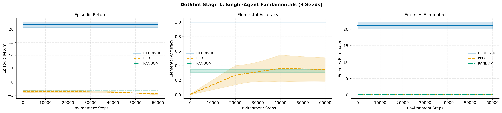

# 4. Living Experiments and Benchmark Log

This chapter records every empirical benchmark run on **DotShot Game v2** in chronological milestone order. All numbers come directly from logged `metrics.jsonl` trajectories and automated `benchmarks/eval/evaluate.py` summaries.

---

## 4.1 Reproducibility and Statistical Protocol

- **Workstation Hardware**: Windows 11/10, **NVIDIA GeForce RTX 3060 (12 GB VRAM)**, PyTorch `2.6.0+cu124`, Python `3.11.18`.
- **Configuration & Seeding**: Every run executes from a versioned YAML file in `configs/` with deterministic seeding (`seed_everything`) across `random`, `numpy`, `torch`, and environment instances.
- **Statistical Reporting Standard**: Following **Agarwal et al. (2021)** [@agarwal2021rliable] and **Gorsane et al. (2022)** [@gorsane2022marleval], we report **Interquartile Mean (IQM)** with **95% bootstrap confidence intervals** ($B = 2{,}000$ resamples) alongside mean win rate, Core survival ratio, elemental accuracy, and kills per episode.

---

## 4.2 Milestone 1: Initial Single-Agent & Cooperative Smoke Benchmarks

Milestone 1 validates the end-to-end training, `rliable` evaluation, and 300 DPI plotting pipelines across single-agent Stages 1–2 and a 40,000-step cooperative smoke benchmark on Stage 3. Every summary table below reports the exact output emitted by `benchmarks/eval/evaluate.py` (`2,000` bootstrap resamples).

### 4.2.1 Stage 1 Single-Agent Fundamentals (60,000 steps, 3 seeds)

| Algorithm | Seeds | Final Return IQM [95% CI] | Best Return IQM [95% CI] | Win Rate (%) | Core HP (%) | Elem Acc (%) | Kills / Ep |
| :--- | :---: | :---: | :---: | :---: | :---: | :---: | :---: |
| `HEURISTIC` | 3 | 21.63 [20.19, 22.57] | 21.63 [20.19, 22.57] | 97.9% | 100.0% | 100.0% | 21.1 |
| `PPO` | 3 | -4.47 [-4.95, -4.00] | -3.46 [-4.00, -3.15] | 0.0% | 100.0% | 34.7% | 0.1 |
| `RANDOM` | 3 | -3.04 [-3.08, -2.99] | -3.04 [-3.08, -2.99] | 0.0% | 100.0% | 32.6% | 0.0 |

**Quantitative & Qualitative Analysis**:
- **Scripted Anchor**: `HEURISTIC` reaches `21.63 [20.19, 22.57]` episodic return, `97.9%` win rate, `100.0%` elemental accuracy, and `21.1` kills per episode. Because Stage 1 spawns only `Fire` enemies and four symmetric pillars, linear velocity target leading paired with fixed `Water` shots nearly solves the stage.
- **Short-Budget PPO Underfitting**: Over `60,000` timesteps (`3` seeds), SB3 `PPO` (`@schulman2017ppo`) ends at `-4.47 [-4.95, -4.00]` (`0.0%` wins, `0.1` kills/episode), trailing uniform `RANDOM` (`-3.04 [-3.08, -2.99]`). Elemental accuracy climbs from `0.0%` at step `0` to `34.7%` (near the `33.3%` uniform 3-weapon baseline) as the policy begins triggering `Water` shots, yet `60k` steps is too short to coordinate the `32`-bin aim head with kiting. Repeated misses and contact damage pull PPO slightly below random movement.

---

### 4.2.2 Stage 2 Elemental Mastery (80,000 steps, 3 seeds)

| Algorithm | Seeds | Final Return IQM [95% CI] | Best Return IQM [95% CI] | Win Rate (%) | Core HP (%) | Elem Acc (%) | Kills / Ep |
| :--- | :---: | :---: | :---: | :---: | :---: | :---: | :---: |
| `HEURISTIC` | 3 | 9.70 [9.19, 10.58] | 9.70 [9.19, 10.58] | 0.0% | 100.0% | 99.7% | 10.9 |
| `PPO` | 3 | -3.48 [-3.89, -3.25] | -2.98 [-3.30, -2.73] | 0.0% | 100.0% | 17.8% | 0.0 |
| `RANDOM` | 3 | -2.72 [-2.83, -2.64] | -2.72 [-2.83, -2.64] | 0.0% | 100.0% | 31.6% | 0.0 |

**Quantitative & Qualitative Analysis**:
- **Difficulty Jump on the Heuristic**: Introducing all three element types, incoming enemy projectiles, and neutral allies cuts `HEURISTIC` return by more than half, from `21.63` to `9.70 [9.19, 10.58]` (`0.0%` win rate, `10.9` kills/episode, `99.7%` elemental accuracy). Because the scripted baseline only kites radially from the nearest enemy without dodging incoming bullets or routing around cover, mixed enemy fire wears down its `100` HP before wave completion.
- **PPO vs. Three-Way Switching**: At `80,000` steps, `PPO` reaches `-3.48 [-3.89, -3.25]` (`-2.98` best) with `17.8%` elemental accuracy and `0.0` kills/episode, below `RANDOM` (`-2.72`, `31.6%` elemental accuracy). Learning simultaneous target leading, three-element switching, projectile evasion, and neutral-ally restraint requires longer horizon budgets (`300k–1M` steps) or curriculum transfer from a converged Stage 1 policy.

---

### 4.2.3 Stage 3 Cooperative Core Defense Smoke Benchmark (40,000 steps on RTX 3060 CUDA, 2 seeds)

| Algorithm | Seeds | Final Return IQM [95% CI] | Best Return IQM [95% CI] | Win Rate (%) | Core HP (%) | Elem Acc (%) | Kills / Ep |
| :--- | :---: | :---: | :---: | :---: | :---: | :---: | :---: |
| `MAT` | 2 | -2.16 [-2.26, -2.06] | -2.06 [-2.26, -1.86] | 0.0% | 21.2% | 31.7% | 0.1 |
| `QMIX` | 2 | -2.19 [-2.33, -2.04] | -2.02 [-2.04, -1.99] | 0.0% | 22.7% | 52.1% | 0.1 |
| `MAPPO` | 2 | -2.30 [-2.40, -2.21] | -2.20 [-2.21, -2.20] | 0.0% | 29.3% | 32.2% | 0.1 |
| `IPPO` | 2 | -2.52 [-2.53, -2.50] | -2.36 [-2.53, -2.20] | 0.0% | 7.0% | 30.1% | 0.1 |
| `HAPPO` | 2 | -2.78 [-3.12, -2.44] | -2.20 [-2.29, -2.12] | 0.0% | 2.2% | 16.8% | 0.1 |

> [!TIP]
> **Recorded Evaluation Replay**: Watch the Stage 3 policy rollout captured via `enjoy.py --record`: [Stage 3 MARL Gameplay Replay (MP4)](assets/videos/dotshot_stage3_demo.mp4).

**Quantitative & Qualitative Comparison (40k-Step Smoke Regime)**:

Because `40,000` environment steps on `2` seeds represent a short verification run rather than converged training, all five MARL algorithms stay at `0.0%` win rate and `0.1` kills/episode. Even in this early window, clear behavioral differences separate value factorization, shared-parameter actor-critics, sequential transformers, and independent or heterogeneous trust-region updates:

1. **`MAT` (`-2.16` Final Return, `21.2%` Core HP, `31.7%` Elem Acc)**: Multi-Agent Transformer (`@wen2022mat`) achieves the highest final return IQM (`-2.16 [-2.26, -2.06]`) and rebounds steadily after `20k` steps. Cross-agent attention over both Strikers' `129`-dim observations reduces wasted overlap near the Core during early exploration.
2. **`Branching-QMIX` (`-2.19` Final Return, `-2.02` Best Return, `52.1%` Elem Acc)**: Combining QMIX monotonic mixing (`@rashid2018qmix`) with Branching Dueling Q-heads (`@tavakoli2018branching`) produces the best peak return (`-2.02 [-2.04, -1.99]`) and the clearest learning signal on **elemental accuracy (`52.1%`)**, climbing sharply between `20k` and `40k` steps. Off-policy TD backups from the replay buffer directly reinforce the 4-choice weapon branch whenever counter-element hits occur, avoiding the high-variance policy-gradient credit noise seen in on-policy runs.
3. **`MAPPO` (`-2.30` Final Return, `29.3%` Core HP, `32.2%` Elem Acc)**: Shared-parameter MAPPO (`@yu2022mappo`) achieves the highest **Core survival (`29.3%`)** at `40k` steps, rising steeply from `7%` at step `20k`. Conditioning the centralized critic on `env.state()` stabilizes early Core-defense positioning because both Stage 3 agents are homogeneous `Striker` units that benefit from doubled gradient throughput via parameter sharing.
4. **`IPPO` (`-2.52` Final Return, `7.0%` Core HP, `30.1%` Elem Acc)**: Independent PPO (`@dewitt2020ippo`) flattens near `-2.52` while Core survival drops steadily from `24%` to `7.0%`. Without centralized state access or cross-agent conditioning, each independent critic tracks a moving target under LOS partial observability.
5. **`HAPPO` (`-2.78` Final Return, `2.2%` Core HP, `16.8%` Elem Acc)**: Sequential heterogeneous updates (`@kuba2022happo`) perform worst in the `40k`-step smoke window (`-2.78 [-3.12, -2.44]`). Unlike shared `MAPPO` or `MAT`, `HAPPO` maintains separate actor parameters per agent without weight sharing, halving per-network sample reuse on a 2-agent homogeneous team. Milestone 2 (`200k+` steps across `5` seeds on Stages 3 and 4) will test whether `HAPPO` catches up on Stage 3 and pulls ahead of shared `MAPPO` when Stage 4 introduces asymmetric `Vanguard`, `Striker`, and `Support` roles.
