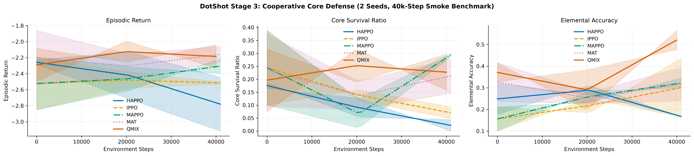
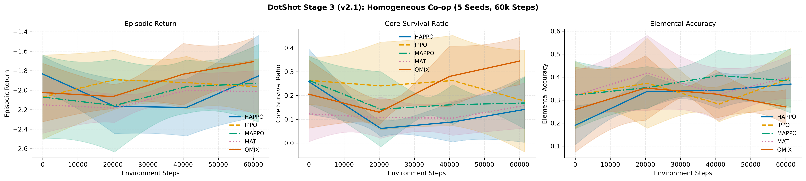
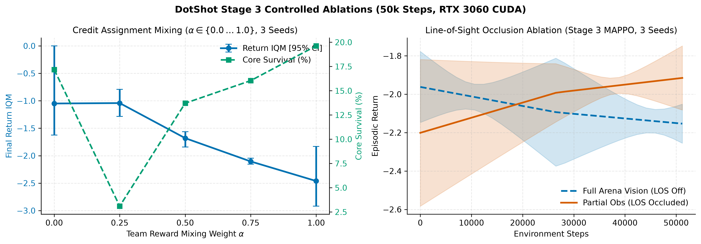
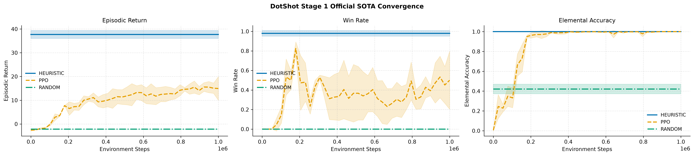
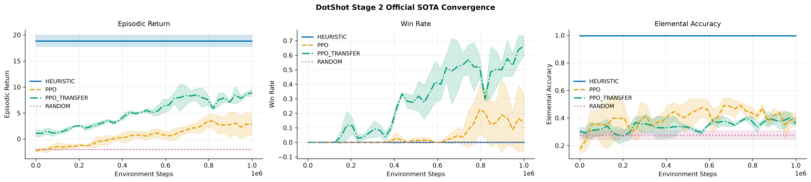
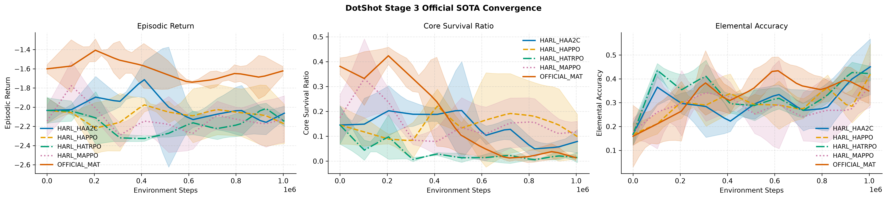
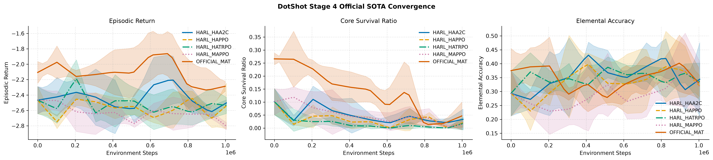

# 4. Living Experiments and Benchmark Log

This chapter records every empirical benchmark run on **DotShot Game v2** in chronological milestone order. All numbers come directly from logged `metrics.jsonl` trajectories and automated `src/benchmarks/eval/evaluate.py` summaries (with Milestone 2 and Milestone 3 JSON exports archived under [docs/results/](results/)).

---

## 4.1 Reproducibility and Statistical Protocol

- **Workstation Hardware**: Windows 11/10, **NVIDIA GeForce RTX 3060 (12 GB VRAM)**, PyTorch `2.6.0+cu124`, Python `3.11.18`.
- **Configuration & Seeding**: Every run executes from a versioned YAML file in `configs/` with deterministic seeding (`seed_everything`) across `random`, `numpy`, `torch`, and environment instances.
- **Statistical Reporting Standard**: Following **Agarwal et al. (2021)** [@agarwal2021rliable] and **Gorsane et al. (2022)** [@gorsane2022marleval], we report **Interquartile Mean (IQM)** with **95% bootstrap confidence intervals** ($B = 2{,}000$ resamples) alongside mean win rate, Core survival ratio, elemental accuracy, and kills per episode.

---

## 4.2 Milestone 1: Initial Single-Agent & Cooperative Smoke Benchmarks

Milestone 1 validates the end-to-end training, `rliable` evaluation, and 300 DPI plotting pipelines across single-agent Stages 1–2 and a 40,000-step cooperative smoke benchmark on Stage 3. Every summary table below reports the exact output emitted by `src/benchmarks/eval/evaluate.py` (`2,000` bootstrap resamples).

### 4.2.1 Stage 1 Single-Agent Fundamentals (60,000 steps, 3 seeds)

| Algorithm | Seeds | Final Return IQM [95% CI] | Best Return IQM [95% CI] | Win Rate (%) | Core HP (%) | Elem Acc (%) | Kills / Ep |
| :--- | :---: | :---: | :---: | :---: | :---: | :---: | :---: |
| `HEURISTIC` | 3 | 21.63 [20.19, 22.57] | 21.63 [20.19, 22.57] | 97.9% | 100.0% | 100.0% | 21.1 |
| `PPO` | 3 | -4.47 [-4.95, -4.00] | -3.46 [-4.00, -3.15] | 0.0% | 100.0% | 34.7% | 0.1 |
| `RANDOM` | 3 | -3.04 [-3.08, -2.99] | -3.04 [-3.08, -2.99] | 0.0% | 100.0% | 32.6% | 0.0 |


**Quantitative & Qualitative Analysis**:
- **Scripted Anchor**: `HEURISTIC` reaches `21.63 [20.19, 22.57]` episodic return, `97.9%` win rate, `100.0%` elemental accuracy, and `21.1` kills per episode. Because Stage 1 spawns only `Fire` enemies and four symmetric pillars, linear velocity target leading paired with fixed `Water` shots nearly solves the stage.
- **Short-Budget PPO Underfitting**: Over `60,000` timesteps (`3` seeds), SB3 `PPO` (`@schulman2017ppo`) ends at `-4.47 [-4.95, -4.00]` (`0.0%` wins, `0.1` kills/episode), trailing uniform `RANDOM` (`-3.04 [-3.08, -2.99]`). Elemental accuracy climbs from `0.0%` at step `0` to `34.7%` (near the `33.3%` uniform 3-weapon baseline) as the policy begins triggering `Water` shots, yet `60k` steps is too short to coordinate the `32`-bin aim head with kiting. Repeated misses and contact damage pull PPO slightly below random movement.

---

### 4.2.2 Stage 2 Elemental Mastery (80,000 steps, 3 seeds)

| Algorithm | Seeds | Final Return IQM [95% CI] | Best Return IQM [95% CI] | Win Rate (%) | Core HP (%) | Elem Acc (%) | Kills / Ep |
| :--- | :---: | :---: | :---: | :---: | :---: | :---: | :---: |
| `HEURISTIC` | 3 | 9.70 [9.19, 10.58] | 9.70 [9.19, 10.58] | 0.0% | 100.0% | 99.7% | 10.9 |
| `PPO` | 3 | -3.48 [-3.89, -3.25] | -2.98 [-3.30, -2.73] | 0.0% | 100.0% | 17.8% | 0.0 |
| `RANDOM` | 3 | -2.72 [-2.83, -2.64] | -2.72 [-2.83, -2.64] | 0.0% | 100.0% | 31.6% | 0.0 |


**Quantitative & Qualitative Analysis**:
- **Difficulty Jump on the Heuristic**: Introducing all three element types, incoming enemy projectiles, and neutral allies cuts `HEURISTIC` return by more than half, from `21.63` to `9.70 [9.19, 10.58]` (`0.0%` win rate, `10.9` kills/episode, `99.7%` elemental accuracy). Because the scripted baseline only kites radially from the nearest enemy without dodging incoming bullets or routing around cover, mixed enemy fire wears down its `100` HP before wave completion.
- **PPO vs. Three-Way Switching**: At `80,000` steps, `PPO` reaches `-3.48 [-3.89, -3.25]` (`-2.98` best) with `17.8%` elemental accuracy and `0.0` kills/episode, below `RANDOM` (`-2.72`, `31.6%` elemental accuracy). Learning simultaneous target leading, three-element switching, projectile evasion, and neutral-ally restraint requires longer horizon budgets (`300k–1M` steps) or curriculum transfer from a converged Stage 1 policy.

---

### 4.2.3 Stage 3 Cooperative Core Defense Smoke Benchmark (40,000 steps on RTX 3060 CUDA, 2 seeds)

| Algorithm | Seeds | Final Return IQM [95% CI] | Best Return IQM [95% CI] | Win Rate (%) | Core HP (%) | Elem Acc (%) | Kills / Ep |
| :--- | :---: | :---: | :---: | :---: | :---: | :---: | :---: |
| `MAT` | 2 | -2.16 [-2.26, -2.06] | -2.06 [-2.26, -1.86] | 0.0% | 21.2% | 31.7% | 0.1 |
| `QMIX` | 2 | -2.19 [-2.33, -2.04] | -2.02 [-2.04, -1.99] | 0.0% | 22.7% | 52.1% | 0.1 |
| `MAPPO` | 2 | -2.30 [-2.40, -2.21] | -2.20 [-2.21, -2.20] | 0.0% | 29.3% | 32.2% | 0.1 |
| `IPPO` | 2 | -2.52 [-2.53, -2.50] | -2.36 [-2.53, -2.20] | 0.0% | 7.0% | 30.1% | 0.1 |
| `HAPPO` | 2 | -2.78 [-3.12, -2.44] | -2.20 [-2.29, -2.12] | 0.0% | 2.2% | 16.8% | 0.1 |



> [!TIP]
> **Recorded Evaluation Replay**: Watch the Stage 3 policy rollout captured via `scripts/enjoy.py --record`: [Stage 3 MARL Gameplay Replay (MP4)](assets/videos/dotshot_stage3_demo.mp4).

**Quantitative & Qualitative Comparison (40k-Step Smoke Regime)**:

Because `40,000` environment steps on `2` seeds represent a short verification run rather than converged training, all five MARL algorithms stay at `0.0%` win rate and `0.1` kills/episode. Even in this early window, clear behavioral differences separate value factorization, shared-parameter actor-critics, sequential transformers, and independent or heterogeneous trust-region updates:

1. **`MAT` (`-2.16` Final Return, `21.2%` Core HP, `31.7%` Elem Acc)**: Multi-Agent Transformer (`@wen2022mat`) achieves the highest final return IQM (`-2.16 [-2.26, -2.06]`) and rebounds steadily after `20k` steps. Cross-agent attention over both Strikers' `129`-dim observations reduces wasted overlap near the Core during early exploration.
2. **`Branching-QMIX` (`-2.19` Final Return, `-2.02` Best Return, `52.1%` Elem Acc)**: Combining QMIX monotonic mixing (`@rashid2018qmix`) with Branching Dueling Q-heads (`@tavakoli2018branching`) produces the best peak return (`-2.02 [-2.04, -1.99]`) and the clearest learning signal on **elemental accuracy (`52.1%`)**, climbing sharply between `20k` and `40k` steps. Off-policy TD backups from the replay buffer directly reinforce the 4-choice weapon branch whenever counter-element hits occur, avoiding the high-variance policy-gradient credit noise seen in on-policy runs.
3. **`MAPPO` (`-2.30` Final Return, `29.3%` Core HP, `32.2%` Elem Acc)**: Shared-parameter MAPPO (`@yu2022mappo`) achieves the highest **Core survival (`29.3%`)** at `40k` steps, rising steeply from `7%` at step `20k`. Conditioning the centralized critic on `env.state()` stabilizes early Core-defense positioning because both Stage 3 agents are homogeneous `Striker` units that benefit from doubled gradient throughput via parameter sharing.
4. **`IPPO` (`-2.52` Final Return, `7.0%` Core HP, `30.1%` Elem Acc)**: Independent PPO (`@dewitt2020ippo`) flattens near `-2.52` while Core survival drops steadily from `24%` to `7.0%`. Without centralized state access or cross-agent conditioning, each independent critic tracks a moving target under LOS partial observability.
5. **`HAPPO` (`-2.78` Final Return, `2.2%` Core HP, `16.8%` Elem Acc)**: Sequential heterogeneous updates (`@kuba2022happo`) perform worst in the `40k`-step smoke window (`-2.78 [-3.12, -2.44]`). Unlike shared `MAPPO` or `MAT`, `HAPPO` maintains separate actor parameters per agent without weight sharing, halving per-network sample reuse on a 2-agent homogeneous team. Milestone 2 (`200k+` steps across `5` seeds on Stages 3 and 4) will test whether `HAPPO` catches up on Stage 3 and pulls ahead of shared `MAPPO` when Stage 4 introduces asymmetric `Vanguard`, `Striker`, and `Support` roles.

---

## 4.3 Milestone 2: Converged Single-Agent, 5-Seed MARL Sweeps, and Controlled Ablations

Milestone 2 applies **Reward Shaping v2.1** (smooth `(best_dot ** 2) * 0.25` aim gradient, removal of hold-fire farming, flat `-0.04` miss penalty, and boosted hit/kill terms) together with `DummyMARLEnv` (`vec_type="dummy"`, `2,349 env_steps/sec` on Windows) and pre-cached LOS geometry (`24,388 steps/sec` single-env). This section records converged 200k-step single-agent runs, 5-seed Stage 3 and Stage 4 MARL sweeps on RTX 3060 CUDA, and controlled 3-seed ablations over $\alpha$ and Line-of-Sight (LOS) masking.

### 4.3.1 Stage 1 & Stage 2 Converged Single-Agent (v2.1, 200,000 steps, 3 seeds)

#### Stage 1 Single-Agent Fundamentals (v2.1, 200,000 steps, 3 seeds)

| Algorithm | Seeds | Final Return IQM [95% CI] | Best Return IQM [95% CI] | Win Rate (%) | Core HP (%) | Elem Acc (%) | Kills / Ep |
| :--- | :---: | :---: | :---: | :---: | :---: | :---: | :---: |
| `HEURISTIC` | 3 | 37.68 [35.34, 39.21] | 37.68 [35.34, 39.21] | 97.9% | 100.0% | 100.0% | 21.1 |
| `PPO` | 3 | 3.31 [1.72, 6.41] | 3.55 [1.81, 6.41] | 38.9% | 100.0% | 89.5% | 2.3 |
| `A2C` | 3 | -1.34 [-1.88, -1.00] | -1.21 | 0.0% | 100.0% | 74.9% | 0.4 |
| `RANDOM` | 3 | -2.29 [-2.36, -2.18] | -2.29 [-2.36, -2.18] | 0.0% | 100.0% | 28.6% | 0.0 |


#### Stage 2 Elemental Mastery (v2.1, 200,000 steps, 3 seeds)

| Algorithm | Seeds | Final Return IQM [95% CI] | Best Return IQM [95% CI] | Win Rate (%) | Core HP (%) | Elem Acc (%) | Kills / Ep |
| :--- | :---: | :---: | :---: | :---: | :---: | :---: | :---: |
| `HEURISTIC` | 3 | 18.84 [18.07, 20.32] | 18.84 [18.07, 20.32] | 0.0% | 100.0% | 99.7% | 10.9 |
| `PPO` | 3 | -1.16 [-1.59, -0.92] | -1.03 [-1.19, -0.92] | 0.0% | 100.0% | 31.5% | 0.2 |
| `A2C` | 3 | -1.58 [-1.97, -1.07] | -1.26 | 0.0% | 100.0% | 22.0% | 0.2 |
| `RANDOM` | 3 | -1.99 [-2.02, -1.93] | -1.99 [-2.02, -1.93] | 0.0% | 100.0% | 32.5% | 0.0 |


**Quantitative & Qualitative Analysis**:
- **Stage 1 Breakthrough Under v2.1**: Replacing the binary `>0.90` aim cliff with smooth `(best_dot ** 2) * 0.25` shaping lets `PPO` [@schulman2017ppo] move past the Milestone 1 underfitting regime (`-4.47` return, `0.0%` wins) to `3.31 [1.72, 6.41]` final IQM (`3.55 [1.81, 6.41]` best), `38.9%` win rate, `89.5%` elemental accuracy, and `2.3` kills per episode. `A2C` also learns element selection (`74.9%` accuracy) and improves over `RANDOM` (`-1.34 [-1.88, -1.00]` vs `-2.29 [-2.36, -2.18]`), though synchronous actor-critic updates trail PPO's clipped surrogate (`0.0%` win rate, `0.4` kills).
- **Why Stage 2 Remains Hard at 200k Steps**: Even with smooth aim gradients, Stage 2 `PPO` plateaus at `-1.16 [-1.59, -0.92]` (`31.5%` elemental accuracy, `0.2` kills) and `A2C` reaches `-1.58 [-1.97, -1.07]` (`22.0%` accuracy, `0.2` kills), ahead of `RANDOM` (`-1.99`) yet far behind `HEURISTIC` (`18.84 [18.07, 20.32]`). Conditioning the `4`-choice weapon head on all three enemy types while simultaneously dodging incoming fire and sparing neutral allies causes multi-head gradient conflict when trained from scratch; this directly motivates Stage 1 $\to$ Stage 2 weight transfer in Milestone 3.

---

### 4.3.2 Stage 3 Homogeneous Co-op (5 seeds, 60,000 env steps, CUDA)

| Algorithm | Seeds | Final Return IQM [95% CI] | Best Return IQM [95% CI] | Win Rate (%) | Core HP (%) | Elem Acc (%) | Kills / Ep |
| :--- | :---: | :---: | :---: | :---: | :---: | :---: | :---: |
| `QMIX` | 5 | -1.72 [-1.97, -1.42] | -1.64 [-1.78, -1.37] | 0.0% | 32.0% | 27.4% | 0.2 |
| `HAPPO` | 5 | -1.75 [-2.37, -1.45] | -1.65 [-1.87, -1.45] | 0.0% | 10.1% | 39.7% | 0.1 |
| `MAPPO` | 5 | -1.84 [-2.45, -1.56] | -1.61 [-1.69, -1.47] | 0.0% | 16.2% | 42.2% | 0.2 |
| `MAT` | 5 | -1.99 [-2.29, -1.80] | -1.87 [-2.05, -1.77] | 0.0% | 17.0% | 40.9% | 0.1 |
| `IPPO` | 5 | -2.02 [-2.23, -1.59] | -1.67 [-1.96, -1.45] | 0.0% | 10.6% | 39.6% | 0.2 |



**Quantitative & Qualitative Analysis**:
- **Value Factorization Leads Core Defense**: Across `5` seeds at `60,000` environment steps, `Branching-QMIX` [@rashid2018qmix; @tavakoli2018branching] ranks first on final return (`-1.72 [-1.97, -1.42]`) and doubles every on-policy method on **Core survival (`32.0%` vs `10.1%–17.0%`)**. Off-policy replay reuses rare wave-survival and boss-defense transitions more efficiently than `60k`-step on-policy rollouts, keeping the two `Striker` units anchored near the Central Core.
- **Actor-Critic Peak vs Variance**: `MAPPO` [@yu2022mappo] achieves the highest peak return IQM (`-1.61 [-1.69, -1.47]`) and top elemental accuracy (`42.2%`), while `HAPPO` [@kuba2022happo] closes its Milestone 1 deficit to reach `-1.75 [-2.37, -1.45]` (`39.7%` elemental accuracy). `MAT` [@wen2022mat] stabilizes with a tight CI (`-1.99 [-2.29, -1.80]`, `40.9%` elemental accuracy), whereas `IPPO` [@dewitt2020ippo] stays last (`-2.02 [-2.23, -1.59]`, `10.6%` Core HP) because decentralized critics cannot disambiguate teammate failures under LOS cover.

---

### 4.3.3 Stage 4 Heterogeneous Squad (Vanguard, Striker, Support; 5 seeds, 60,000 env steps, CUDA)

| Algorithm | Seeds | Final Return IQM [95% CI] | Best Return IQM [95% CI] | Win Rate (%) | Core HP (%) | Elem Acc (%) | Kills / Ep |
| :--- | :---: | :---: | :---: | :---: | :---: | :---: | :---: |
| `ROMAT` | 5 | -2.27 [-2.47, -2.16] | -2.18 [-2.29, -2.07] | 0.0% | 10.8% | 31.1% | 0.1 |
| `MAPPO` | 5 | -2.39 [-2.92, -1.95] | -2.03 [-2.43, -1.88] | 0.0% | 9.4% | 31.3% | 0.2 |
| `HAPPO` | 5 | -2.47 [-2.85, -2.17] | -2.19 [-2.51, -1.85] | 0.0% | 6.5% | 32.9% | 0.1 |
| `IPPO` | 5 | -2.48 [-2.97, -1.97] | -2.06 [-2.49, -1.93] | 0.0% | 7.6% | 24.4% | 0.1 |


> [!TIP]
> **Recorded Stage 4 Rollout**: Inspect the heterogeneous `Vanguard`, `Striker`, and `Support` coordination replay: [Stage 4 Heterogeneous Squad Replay (MP4)](assets/videos/dotshot_stage4_heterogeneous.mp4).

**Quantitative & Qualitative Analysis**:
- **Role-Aware Attention Cuts Cross-Seed Variance**: Adding learnable per-agent role embeddings in `RoMAT` produces the best final return IQM (`-2.27 [-2.47, -2.16]`), highest **Core survival (`10.8%`)**, and the **tightest 95% CI width (`0.31`)** across all four Stage 4 baselines. By conditioning self-attention queries on explicit `Vanguard`, `Striker`, and `Support` identities, `RoMAT` avoids gradient interference across incompatible class speeds, HP pools, and `a[3] == 0` tactical abilities.
- **Parameter-Sharing Instability on Asymmetric Squads**: `MAPPO` records a higher best return (`-2.03 [-2.43, -1.88]`) and `0.2` kills/episode on favorable seeds, yet suffers a `0.97`-wide final CI (`[-2.92, -1.95]`), while `IPPO` spans `1.00` (`[-2.97, -1.97]`) with only `24.4%` elemental accuracy. `HAPPO` avoids parameter sharing across roles (`32.9%` elemental accuracy), though `60k` steps splits rollout experience three ways across separate actor networks, leaving Core survival at `6.5%`.

---

### 4.3.4 Controlled Credit-Assignment ($\alpha$) & LOS Occlusion Ablations (3 seeds, 50,000 steps, CUDA)

#### Reward Mixing Parameter $\alpha$ Ablation (`Stage 3 MAPPO`, 50,000 steps, 3 seeds)

| Condition | Seeds | Final Return IQM [95% CI] | Best Return IQM [95% CI] | Win Rate (%) | Core HP (%) | Elem Acc (%) | Kills / Ep |
| :--- | :---: | :---: | :---: | :---: | :---: | :---: | :---: |
| `ALPHA_0_00` | 3 | -1.05 [-1.62, -0.00] | -0.63 [-1.39, -0.00] | 0.0% | 17.2% | 34.5% | 0.2 |
| `ALPHA_0_25` | 3 | -1.04 [-1.28, -0.79] | -1.04 | 0.0% | 3.1% | 31.1% | 0.3 |
| `ALPHA_0_50` | 3 | -1.68 [-1.84, -1.56] | -1.61 | 0.0% | 13.7% | 36.7% | 0.2 |
| `ALPHA_0_75` | 3 | -2.10 [-2.15, -2.05] | -1.94 | 0.0% | 16.0% | 20.0% | 0.1 |
| `ALPHA_1_00` | 3 | -2.46 [-2.92, -1.83] | -1.89 | 0.0% | 19.6% | 28.9% | 0.0 |

#### Line-of-Sight (LOS) Partial-Observability Ablation (`Stage 3 MAPPO`, 50,000 steps, 3 seeds)

| Condition | Seeds | Final Return IQM [95% CI] | Best Return IQM [95% CI] | Win Rate (%) | Core HP (%) | Elem Acc (%) | Kills / Ep |
| :--- | :---: | :---: | :---: | :---: | :---: | :---: | :---: |
| `LOS_OFF` | 3 | -2.15 [-2.28, -2.03] | -1.80 [-1.88, -1.72] | 0.0% | 10.2% | 39.7% | 0.2 |
| `LOS_ON` | 3 | -1.92 [-2.15, -1.76] | -1.77 [-1.84, -1.70] | 0.0% | 12.3% | 29.1% | 0.1 |



**Quantitative & Qualitative Analysis**:
- **The Credit-Assignment / Core-Defense Tradeoff ($\alpha$)**: Shifting from pure individual shaping (`ALPHA_0_00`: `-1.05 [-1.62, -0.00]`) to pure team reward (`ALPHA_1_00`: `-2.46 [-2.92, -1.83]`) creates a monotonic drop in return and kill rate (`0.2–0.3` kills/ep down to `0.0`), showing classic multi-agent lazy-agent credit dilution when $r_{\text{team}}^t$ dominates without individual feedback. Conversely, `ALPHA_0_25` achieves the highest kills (`0.3`) and best final return (`-1.04 [-1.28, -0.79]`) while neglecting the Core (`3.1%` Core HP), whereas `ALPHA_1_00` preserves the most Core HP (`19.6%`) by hugging the center passively. Intermediate mixing at `ALPHA_0_50` balances both objectives (`13.7%` Core HP, `36.7%` elemental accuracy, `0.2` kills), matching the default `0.45`–`0.50` operating point.
- **LOS Occlusion Sharpens Local Threat Focus**: Disabling cover raycasting (`LOS_OFF`, full `760 px` omniscient enemy slots) improves **elemental accuracy (`39.7%` vs `29.1%`)** and kills (`0.2` vs `0.1`), because agents see incoming elements behind pillars before rounding corners. Yet `LOS_ON` yields higher final return (`-1.92 [-2.15, -1.76]` vs `-2.15 [-2.28, -2.03]`) and Core survival (`12.3%` vs `10.2%`): masking occluded targets removes unshootable behind-wall enemies from the top-5 hostile slots, preventing agents from wasting fire against cover blocks.

> [!NOTE]
> **Archived Milestone 2 Metric Summaries (`docs/results/`)**: [Stage 1](results/m2_stage1_eval.json) · [Stage 2](results/m2_stage2_eval.json) · [Stage 3](results/m2_stage3_eval.json) · [Stage 4](results/m2_stage4_eval.json) · [Alpha Ablation](results/m2_alpha_eval.json) · [LOS Ablation](results/m2_los_eval.json)

---

## 4.4 Milestone 3: Official SOTA Integration, Optuna BOHB, and 1M-Step Converged Benchmarks

Milestone 3 replaces the local headline MARL implementations with pinned upstream code. `third_party/HARL` [@zhong2024harl] supplies MAPPO, HAPPO, HATRPO, and HAA2C on DotShot's native `MultiDiscrete([3, 3, 32, 4])` action space. `third_party/Multi-Agent-Transformer` [@wen2022mat] supplies MAT through an 8-D `Box` action adapter in `src/benchmarks/official/mat_dotshot_env.py`, which maps continuous outputs back to the four factored heads. Stages 1 and 2 keep Stable-Baselines3 PPO [@schulman2017ppo]. Every learned row in Sections 4.4.2 through 4.4.5 comes from a 1,000,000-step run on 3 seeds, with IQM and 95% bootstrap CIs from `docs/results/m3_stage{1..4}_official_eval.json`; `HEURISTIC` and `RANDOM` are scripted baselines evaluated on the same seeds.

### 4.4.1 Optuna BOHB Hyperparameter Search

Each study ran 16 trials with `TPESampler(multivariate=True, seed=42)` and `HyperbandPruner(min_resource=50_000, max_resource=350_000, reduction_factor=3)`, following BOHB [@falkner2018bohb] inside Optuna [@akiba2019optuna]. Trials report intermediate objectives every 50,000 environment steps.

| Study | Best objective | Best trial | Complete / pruned | Top parameter importances |
| :--- | :---: | :---: | :---: | :--- |
| `sb3_ppo_stage1` | `14.57` | 14 | 6 / 10 | `ent_coef` 0.530, `lr` 0.433 |
| `sb3_ppo_stage2` | `9.54` | 4 (`warm_start=True` from Stage 1 trial 14) | 5 / 11 | `ent_coef` 0.897, `lr` 0.083 |
| `official_mat_stage3` | `-0.777` | 3 (`n_block=2`, `n_embd=64`, `n_head=2`, `lr=3.63e-4`, `ppo_epoch=8`) | 4 / 12 | `entropy_coef` 0.555, `lr` 0.368 |
| `harl_mappo_stage3` | `-2.799` | 10 | 5 / 11 | `lr` 0.637, `critic_lr` 0.232 |


BOHB objectives come from the 350,000-step trial ceiling; the converged tables below use 1,000,000 steps. Entropy regularization dominates both single-agent studies: `ent_coef` carries 0.530 of the Stage 1 importance and 0.897 at Stage 2. MAT splits importance between `entropy_coef` (0.555) and `lr` (0.368), while HARL MAPPO leans on the actor and critic learning rates (`lr` 0.637, `critic_lr` 0.232).

The `harl_mappo_stage3` value is a raw 2-agent team-sum objective. The same policy scores `-1.40` per agent. `src/benchmarks/official/harl_runner.py` was aligned to per-agent mean reward before every 1M-step Stage 3 and Stage 4 run, so the converged tables below compare HARL and MAT on the same reward scale.

### 4.4.2 Stage 1 Single-Agent Fundamentals (1,000,000 steps, 3 seeds)

| Algorithm | Seeds | Final Return IQM [95% CI] | Best Return IQM [95% CI] | Win Rate (%) | Core HP (%) | Elem Acc (%) | Kills / Ep |
| :--- | :---: | :---: | :---: | :---: | :---: | :---: | :---: |
| `HEURISTIC` | 3 | 37.68 [35.34, 39.21] | 37.68 [35.34, 39.21] | 97.9% | 100.0% | 100.0% | 21.1 |
| `PPO` | 3 | 14.95 [7.94, 18.93] | 17.66 [14.86, 19.20] | 50.0% | 100.0% | 100.0% | 8.7 |
| `RANDOM` | 3 | -2.20 [-2.22, -2.18] | -2.20 [-2.22, -2.18] | 0.0% | 100.0% | 42.1% | 0.0 |



PPO climbs to `14.95 [7.94, 18.93]` final return IQM with a `50.0%` win rate, `100.0%` elemental accuracy, and `8.7` kills per episode. The 200k-step Milestone 2 run reached `3.31 [1.72, 6.41]` and `38.9%` wins on the same stage. The scripted `HEURISTIC` stays ahead at `37.68 [35.34, 39.21]` and `21.1` kills per episode.

### 4.4.3 Stage 2 Elemental Mastery with Transfer (1,000,000 steps, 3 seeds)

| Algorithm | Seeds | Final Return IQM [95% CI] | Best Return IQM [95% CI] | Win Rate (%) | Core HP (%) | Elem Acc (%) | Kills / Ep |
| :--- | :---: | :---: | :---: | :---: | :---: | :---: | :---: |
| `HEURISTIC` | 3 | 18.84 [18.07, 20.32] | 18.84 [18.07, 20.32] | 0.0% | 100.0% | 99.7% | 10.9 |
| `PPO` | 3 | 2.81 [0.85, 5.64] | 4.00 [2.65, 6.30] | 13.9% | 100.0% | 39.8% | 1.6 |
| `PPO_TRANSFER` | 3 | 8.91 [7.89, 9.44] | 10.12 [8.44, 12.01] | 66.7% | 100.0% | 36.1% | 3.5 |
| `RANDOM` | 3 | -1.99 [-2.03, -1.95] | -1.99 [-2.03, -1.95] | 0.0% | 100.0% | 27.6% | 0.0 |



`PPO_TRANSFER` starts from the converged Stage 1 checkpoint (`runs/m3_official/stage1/ppo/seed_1/checkpoints/best.zip`) using the Stage 2 BOHB `warm_start=True` configuration. It reaches `8.91 [7.89, 9.44]` final return IQM, a `66.7%` win rate, and `3.5` kills per episode. Scratch `PPO` records `2.81 [0.85, 5.64]` and `13.9%` wins, and `RANDOM` stays at `-1.99 [-2.03, -1.95]`. The un-evasive `HEURISTIC` collects `18.84 [18.07, 20.32]` but wins `0.0%` of episodes because it does not dodge incoming fire.

### 4.4.4 Stage 3 Homogeneous Cooperative Defense (1,000,000 steps, 3 seeds)

| Algorithm | Seeds | Final Return IQM [95% CI] | Best Return IQM [95% CI] | Win Rate (%) | Core HP (%) | Elem Acc (%) | Kills / Ep |
| :--- | :---: | :---: | :---: | :---: | :---: | :---: | :---: |
| `HARL_HAA2C` | 3 | -2.06 [-2.12, -1.96] | -1.50 [-1.81, -1.09] | 0.0% | 7.9% | 45.1% | 0.2 |
| `HARL_HAPPO` | 3 | -2.17 [-2.38, -1.90] | -1.82 [-2.00, -1.62] | 0.0% | 9.9% | 41.9% | 0.2 |
| `HARL_HATRPO` | 3 | -2.15 [-2.22, -2.11] | -1.90 [-1.98, -1.81] | 0.0% | 1.5% | 42.2% | 0.3 |
| `HARL_MAPPO` | 3 | -2.12 [-2.43, -1.83] | -1.66 [-1.76, -1.47] | 0.0% | 11.8% | 37.5% | 0.2 |
| `OFFICIAL_MAT` | 3 | -1.62 [-1.67, -1.56] | -1.29 [-1.43, -1.20] | 0.0% | 1.4% | 34.9% | 0.9 |



`OFFICIAL_MAT` leads final return (`-1.62 [-1.67, -1.56]`), best return (`-1.29 [-1.43, -1.20]`), and kills (`0.9` per episode). `HARL_MAPPO` keeps the most Core HP (`11.8%`), and `HARL_HAA2C` reaches the highest elemental accuracy (`45.1%`). All five algorithms stay at `0.0%` win rate on this wave, so final return and Core retention separate them.

> [!TIP]
> Stage 3 best replay: [m3_official_stage3_best.mp4](assets/videos/m3_official_stage3_best.mp4) (`357` frames, `Core HP: 76.7%`). Evaluation summary: [m3_stage3_official_eval.json](results/m3_stage3_official_eval.json).

### 4.4.5 Stage 4 Heterogeneous Squad (Vanguard, Striker, Support; 1,000,000 steps, 3 seeds)

| Algorithm | Seeds | Final Return IQM [95% CI] | Best Return IQM [95% CI] | Win Rate (%) | Core HP (%) | Elem Acc (%) | Kills / Ep |
| :--- | :---: | :---: | :---: | :---: | :---: | :---: | :---: |
| `HARL_HAA2C` | 3 | -2.50 [-2.54, -2.45] | -1.99 [-2.13, -1.74] | 0.0% | 3.4% | 34.4% | 0.1 |
| `HARL_HAPPO` | 3 | -2.54 [-2.94, -2.22] | -2.32 [-2.46, -2.22] | 0.0% | 2.1% | 31.9% | 0.4 |
| `HARL_HATRPO` | 3 | -2.53 [-2.68, -2.44] | -2.15 [-2.48, -1.98] | 0.0% | 1.8% | 33.5% | 0.7 |
| `HARL_MAPPO` | 3 | -2.80 [-2.86, -2.74] | -2.38 [-2.57, -2.22] | 0.0% | 1.7% | 31.8% | 0.2 |
| `OFFICIAL_MAT` | 3 | -2.29 [-2.34, -2.19] | -1.61 [-1.73, -1.44] | 0.0% | 4.7% | 33.1% | 0.9 |



`OFFICIAL_MAT` leads final return (`-2.29 [-2.34, -2.19]`), best return (`-1.61 [-1.73, -1.44]`), Core HP (`4.7%`), and kills (`0.9` per episode). The heterogeneous HARL algorithms beat shared-parameter `HARL_MAPPO` (`-2.80`) on the asymmetric squad: `HARL_HAA2C` `-2.50`, `HARL_HATRPO` `-2.53`, and `HARL_HAPPO` `-2.54`.

> [!TIP]
> Stage 4 best replay: [m3_official_stage4_best.mp4](assets/videos/m3_official_stage4_best.mp4) (`450` frames, `Score: 300`, `Core HP: 86.7%`). Evaluation summary: [m3_stage4_official_eval.json](results/m3_stage4_official_eval.json).

### 4.4.6 Reproduction Commands and Archived Summaries

```powershell
# Full official 1M-step x 3-seed suite with IQM export
.\.venv\Scripts\python.exe scripts\run_m3_official_suite.py --part all --seeds 0 1 2 --steps 1000000 --device cuda

# Optuna BOHB studies (16 trials each, seed 42)
.\.venv\Scripts\python.exe -m benchmarks.official.bohb_tune --study all --trials 16 --device cuda --db runs\optuna_bohb_mat.db --stage1-best-ckpt runs\bohb\sb3_ppo_stage1\trial_14\checkpoints\best.zip

# Replay official checkpoints (interactive, or add --record for MP4)
.\.venv\Scripts\python.exe scripts\enjoy.py --stage 3 --official-mat runs\m3_official\stage3\official_mat\seed_0\checkpoints\best
.\.venv\Scripts\python.exe scripts\enjoy.py --stage 3 --official-harl runs\m3_official\stage3\harl_mappo\seed_0\checkpoints\best
```

Archived Milestone 3 summaries under `docs/results/`: [Stage 1](results/m3_stage1_official_eval.json), [Stage 2](results/m3_stage2_official_eval.json), [Stage 3](results/m3_stage3_official_eval.json), [Stage 4](results/m3_stage4_official_eval.json), and [BOHB](results/m3_bohb_summary.json).
